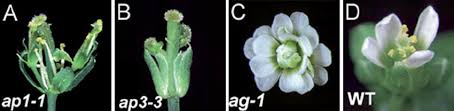
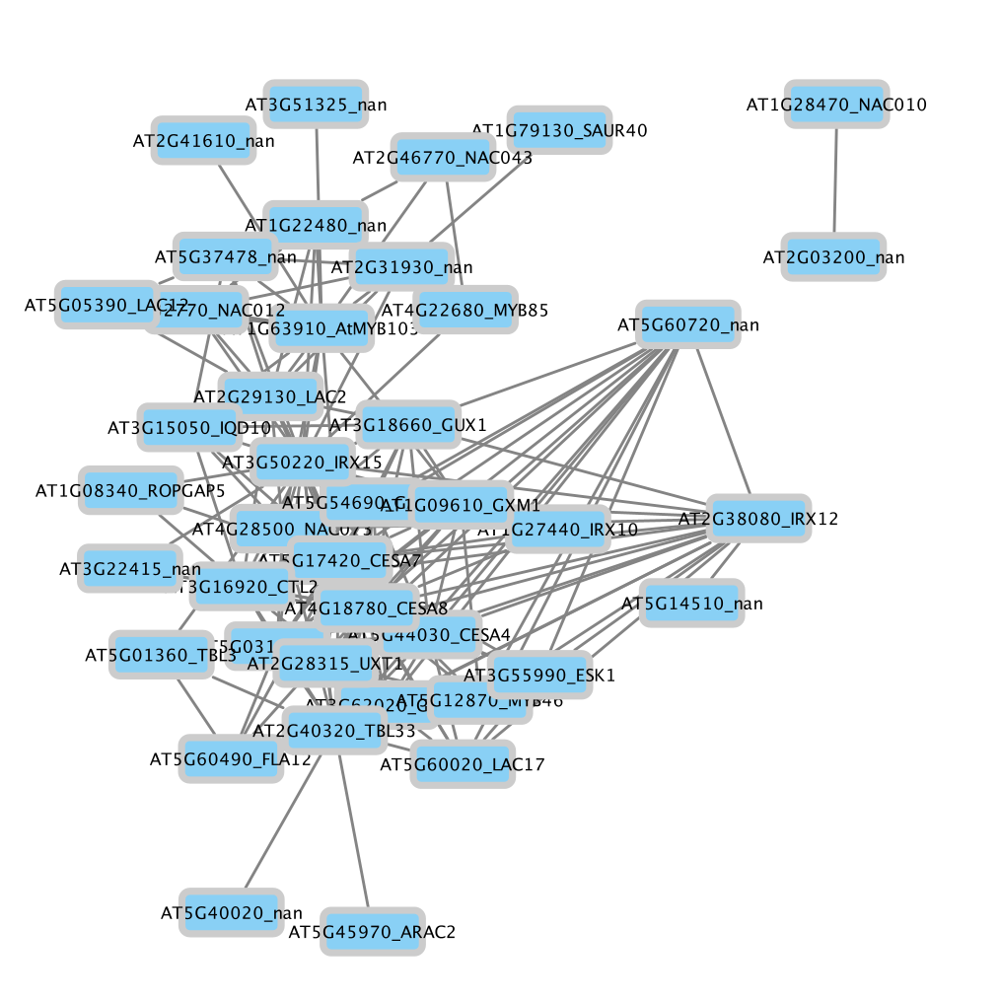
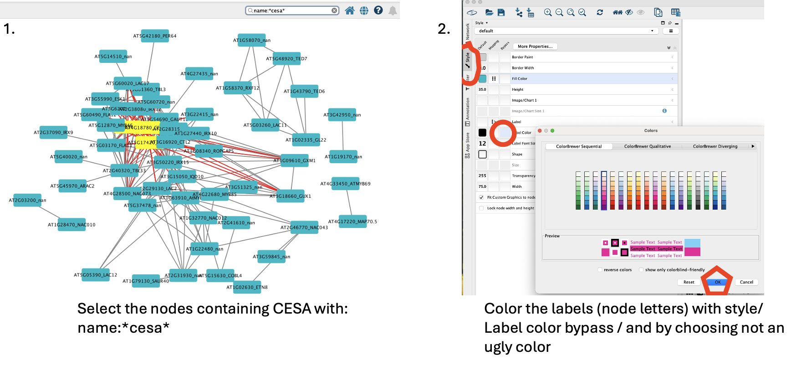
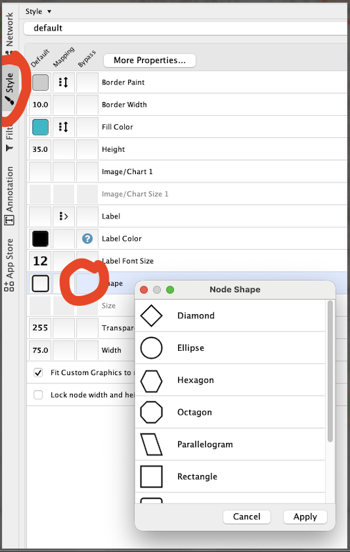
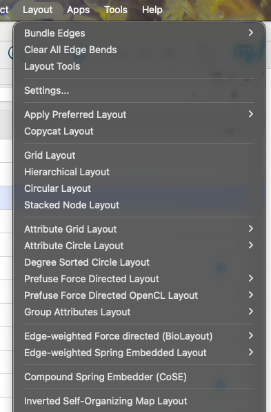
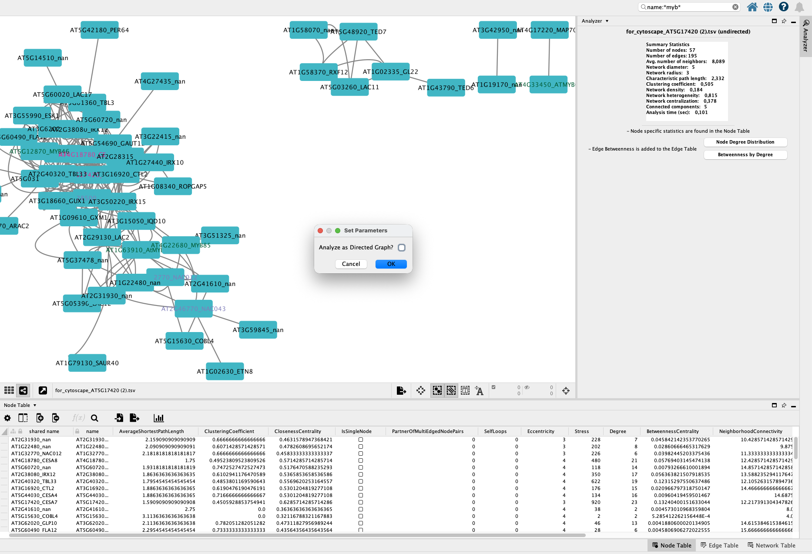
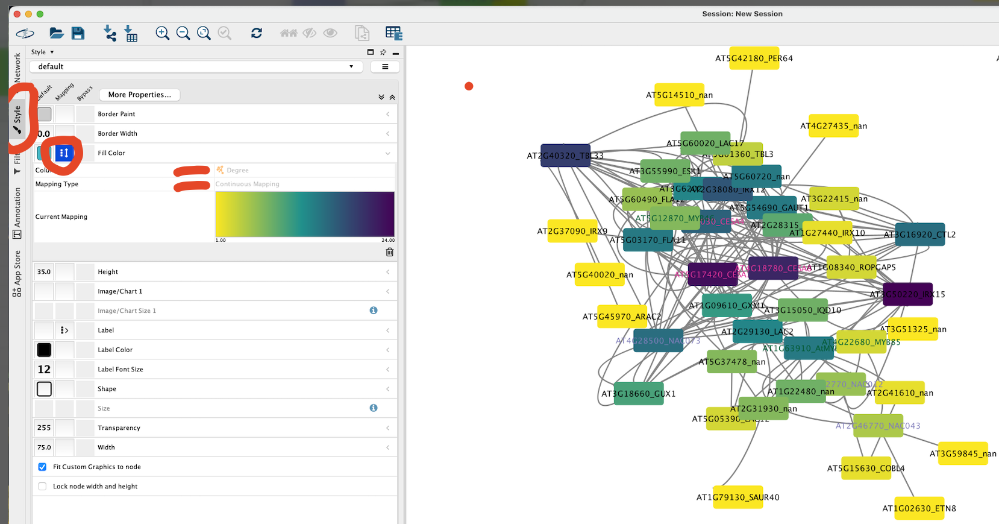

# How this workbook works

Nothing on this page runs in the browser. **Every code block is meant to be copied
into RStudio on ERDA** — the University's own computers, used through your web
browser, so there is nothing to install except Cytoscape in week 2. If you have not used
ERDA before, do the [appendix](#sec-erda) **before the first class**. All files live in
one folder, **`~/work/module4`**; the code downloads every dataset into it for you, so
every block runs verbatim with no editing.

Two kinds of code blocks appear:

- plain code blocks are **R** — paste them into the RStudio console (or, better,
  collect them in a script as you go and run them from there);
- blocks marked **TERMINAL** are shell commands — paste them into RStudio's
  **Terminal** tab, *not* the R console.

Some steps end with a *Your turn* question and a folded **Answer** — try it before you
unfold.

All R code on this page uses **base R only** — no packages to install.

::: {.callout-important title="Files stay, variables do not"}
Everything saved under `~/work` is kept between sessions. But an ERDA session is
switched off after 2 hours of inactivity, and R's memory goes with it: **all variables
are gone** when you come back. That is why each session below starts with a **setup
block** that re-creates everything it needs from the files in `~/work/module4`. If you
see `Error: object 'expr' not found`, scroll up to the session's setup block and run it
again — it is quick, because the files are already downloaded.
:::

Besides the code, three kinds of boxes appear:

::: {.run-local}
Files and setup — what to download, where it goes, and what to rerun after a break.
:::

::: {.web}
Work done on a database website (UniProt, Expression Atlas, ePlant, STRING …), not in
RStudio.
:::

::: {.cytoscape}
Work done in the Cytoscape desktop program on your own computer.
:::

::: {.provenance}
All analyses use public *Arabidopsis thaliana* data. Session 1 downloads raw reads
from the European Nucleotide Archive (BioProject PRJNA314076, the Klepikova et al. 2016
developmental atlas). Sessions 2–6 use the processed version of an Arabidopsis
organ atlas from the **EBI Expression Atlas** (experiment **E-MTAB-7978**: 56 RNA-seq
samples from 23 organs and tissues, TPM values), gene descriptions from **TAIR10**,
and protein–protein interactions from **BioGRID** (release 5.0.250). Everything is
downloaded straight from the source into your ERDA folder.
:::

---

# Schedule {#sec-schedule}

Module 4 runs over two weeks in **October 2026** (weeks 43–44), Tuesday and Thursday
mornings plus Thursday afternoons — taught by **Marek Mutwil** ([mutwil@plen.ku.dk](mailto:mutwil@plen.ku.dk)). The
**Section** column links to the part of this page that goes with each block.

::: {.schedule}
| Date | Time | What happens | Slides / materials | Section |
|:--|:--|:--|:--|:--|
| **Week 43**<br>**Tue 20 Oct** | **09:00–12:00** | **Basic gene expression analysis** | | |
| | 09:00–09:50 | Lecture **M4F1**: Transcriptomics — background and theory | `M4F1 - Transcriptomics Background and theory.pdf` | |
| | 09:50–10:05 | *Break* | | |
| | 10:05–10:20 | Lecture **M4F2**: Normalization metrics in RNA-seq | `M4F2 - Normalization metrics in RNA-seq.pdf` | |
| | 10:20–12:00 | Exercise **M4Ø1**: RStudio on ERDA, and estimating gene expression with kallisto | this workbook | [§1](#sec-o1) |
| **Thu 22 Oct** | **09:00–12:00** | **Exploratory data analysis** | | |
| | 09:00–10:15 | Lecture **M4F3**: Exploratory data analysis (EDA) and data preprocessing | | |
| | 10:15–10:30 | *Break* | | |
| | 10:30–12:00 | Exercise **M4Ø2**: EDA and preprocessing | this workbook | [§2](#sec-o2) |
| | 12:00–13:00 | *Lunch* | | |
| | **13:00–16:00** | **Basic transcriptomics analyses and online databases** | | |
| | 13:00–13:55 | Lecture **M4F4**: Basic transcriptomics analyses and online databases | | |
| | 13:55–14:10 | *Break* | | |
| | 14:10–15:00 | Exercise **M4Ø3**: Co-expression analysis | this workbook | [§3](#sec-o3) |
| | 15:00–15:15 | *Break* | | |
| | 15:15–16:00 | Exercise **M4Ø4**: Transcriptomic databases | this workbook | [§4](#sec-o4) |
| **Week 44**<br>**Tue 27 Oct** | **09:00–12:00** | **Biological networks** | | |
| | 09:00–10:00 | Lecture **M4F5**: Biological networks | `M4F5 - BiologicalNetworks.pdf` | |
| | 10:00–12:00 | Exercise **M4Ø5**: Co-expression network analysis in Cytoscape *(provisional)* | this workbook · [Cytoscape](https://cytoscape.org/download.html) | [§5](#sec-o5) |
| **Thu 29 Oct** | **09:00–12:00** | **Mini-project** | | |
| | 09:00–09:15 | Lecture **M4F6**: Multi-omic network analysis of secondary cell wall biosynthesis | `M4F6 - NetworkProject.pptx`<br>`secondary cell wall regulation.pdf` | [§6](#sec-project) |
| | 09:30–12:00 | Mini-project, and finishing your presentation *(provisional)* | this workbook | [§6](#sec-project) |
| | 12:00–13:00 | *Lunch* | | |
| | **13:00–16:00** | **Peer review and Q&A** | | |
| | 13:00–13:55 | **Peer review** of the mini-project presentations | | [§6.8](#sec-present) |
| | 13:55–14:05 | *Break* | | |
| | 14:05–16:00 | Q&A session (*spørgetime*) | | |
:::

The time plan is tentative and may be adjusted during teaching; Absalon is the
authority if anything changes. **The week 44 exercises (M4Ø5 and the mini-project) are
provisional** — their content may still change before week 44.

**Reading**, to be done *before* the session it belongs to (all on Absalon):

- Tuesday, week 43 — `transcriptomic_databases_plants.pdf`; *TPM vs RPKM explained*
- Thursday, week 43 — `co-expression analysis.pdf`, `bulk atlas.pdf`, `cell atlas.pdf`
- Thursday, week 44 — `secondary cell wall regulation.pdf` (you will also feed this
  review to an AI model in [§6.3](#sec-grn))

::: {.callout-note collapse="true" title="Modul 4 ugeplan (dansk — samme plan som på Absalon)"}
**Foreløbigt skema** (kan blive justeret under undervisningsdagene)

**Underviser:** Marek Mutwil (mutwil@plen.ku.dk)

#### Uge 43 – Genekspressionsanalyse: tirsdag 20. oktober og torsdag 22. oktober

###### Tirsdag, 20-10-2026
*Litteratur:* transcriptomic_databases_plants.pdf, TPM vs RPKM explained

**09:00 – 12:00 Basic gene expression analysis**

- 09:00 – 09:50 Forelæsning M4F1: Transcriptomics: Background and theory
- 09:50 – 10:05 Pause
- 10:05 – 10:20 Forelæsning M4F2: Normalization metrics in RNA-seq
- 10:20 – 12:00 Øvelse M4Ø1: RStudio on ERDA and estimating gene expression with kallisto

###### Torsdag, 22-10-2026
*Litteratur:* co-expression analysis.pdf, bulk atlas.pdf, cell atlas.pdf

**09:00 – 12:00 Exploratory data analysis**

- 09:00 – 10:15 Forelæsning M4F3: Exploratory Data Analysis (EDA) and Data Preprocessing
- 10:15 – 10:30 Pause
- 10:30 – 12:00 Øvelse M4Ø2: EDA and preprocessing

**12:00 – 13:00 Frokostpause**

**13:00 – 16:00 Basic transcriptomics analyses and online databases**

- 13:00 – 13:55 Forelæsning M4F4: Basic transcriptomics analyses and online databases
- 13:55 – 14:10 Pause
- 14:10 – 15:00 Øvelse M4Ø3: Co-expression analysis
- 15:00 – 15:15 Pause
- 15:15 – 16:00 Øvelse M4Ø4: Transcriptomic databases

#### Uge 44 – Biological networks: tirsdag 27. oktober og torsdag 29. oktober

*Øvelserne i uge 44 er foreløbige og kan stadig blive ændret.*

###### Tirsdag, 27-10-2026

**09:00 – 12:00 Biological networks**

- 09:00 – 10:00 Forelæsning M4F5: Biological networks
- 10:00 – 12:00 Øvelse M4Ø5: Co-expression network analysis in Cytoscape *(foreløbig)*

###### Torsdag, 29-10-2026
*Litteratur:* secondary cell wall regulation.pdf

**09:00 – 12:00 Mini-projekt**

- 09:00 – 09:15 Forelæsning M4F6: Multi-omic network analysis of secondary cell wall biosynthesis
- 09:30 – 12:00 Fortsættelse af mini-projekt og færdiggørelse af præsentation *(foreløbig)*

**12:00 – 13:00 Frokostpause**

**13:00 – 16:00 Peer review og spørgetime**

- 13:00 – 13:55 Peer review
- 13:55 – 14:05 Pause
- 14:05 – 16:00 Spørgetime
:::

---

# Session M4Ø1 — RStudio on ERDA, and estimating gene expression with kallisto {#sec-o1}
[Tuesday 20-10-2026 · week 43]{.session-chip}

Today has two halves. First you learn just enough RStudio — the console, a script and
the Terminal — to work through the module. Then you do what every RNA-seq project
starts with: download raw sequencing reads and turn them into **gene expression
values** with *kallisto*.

::: {.run-local}
Start an RStudio session on ERDA ([appendix](#sec-erda)) and make the module folder —
paste this into the **Console** (once is enough; it does nothing if the folder exists):

```r
dir.create("~/work/module4", showWarnings = FALSE)
setwd("~/work/module4")
```

`setwd()` (*set working directory*) makes `~/work/module4` the folder R reads from and
writes to. Each session's setup block starts with it.
:::

## 1.1 RStudio basics: console and script

RStudio has four panes. The **Console** (bottom left) runs whatever you type, at once.
A **script** (*File → New File → R Script*, top left) is a text file of code you keep:
put the cursor on a line and press **Ctrl + Enter** (Mac: **Cmd + Enter**) to send that
line — or a selection — to the console. Lines starting with **`#`** are *comments*: notes
for humans, which R ignores.

Paste this into the console:

```r
print("Hello from R!")
x <- 5
y <- 7
cat("Sum:", x + y, "\n")
```

`x` and `y` are variable *names*; `5` and `7` are their *values*; `<-` assigns the value
to the name.

*Your turn:* open a new script and save it as `~/work/module4/M4_session1.R`. Start it
with a few comment lines: a title, one sentence on what you will learn this week, and
three learning goals. Then add code that creates a variable `my_name` holding your first
name and prints `Hello, my name is ...` — and run it from the script.

::: {.callout-tip collapse="true" title="Answer"}
```r
# Module 4 — Session 1
# This week I learn how to turn raw RNA-seq reads into expression values and analyse them.
# Goals: 1. run R and Linux commands on ERDA
#        2. estimate gene expression with kallisto
#        3. explore an expression matrix and find co-expressed genes

my_name <- "Andreas"
cat("Hello, my name is", my_name, "\n")
```
Keep a script like this for every session — it is your record of what you ran, and you
can rerun all of it at once with **Source**.
:::

Learning R programming is not a goal of this module — but you should be able to
**read** and **modify** existing R code to run a transcriptomic analysis. That is
exactly what the rest of the module asks of you.

## 1.2 Terminal basics: Linux commands

ERDA runs **Linux**. Click the **Terminal** tab, immediately right of **Console**, to
get a Linux command line. Programs that are not R — such as kallisto — run here. Paste
these one at a time:

::: {.terminal}
```bash
cd ~/work/module4                              # 1. go to the module folder
pwd                                            # 2. print working directory: where am I?
ls                                             # 3. list the files here
mkdir myfolder                                 # 4. make a folder ...
ls                                             #    ... and check that it exists
echo "Hello from Linux" > myfolder/hello.txt   # 5. write text into a new file ...
cat myfolder/hello.txt                         #    ... and show its contents
```
:::

The new folder and file also appear in RStudio's **Files** pane (bottom right) — click
the file to open it.

*Your turn:* (1) make a folder called `testdir`; (2) inside it, create a file
`note.txt` containing the text *This is my note*; (3) list the files in `testdir` to
confirm it worked.

::: {.callout-tip collapse="true" title="Answer"}
```bash
mkdir testdir
echo "This is my note" > testdir/note.txt
ls testdir
cat testdir/note.txt
```
`echo "..." > file` writes the text into the file. (`touch testdir/note.txt` would also
create the file — but empty, without the text.)
:::

Useful terminal commands: `cd dirname` (enter a folder), `cd ..` (go up), `ls -lh`
(list with sizes), `mkdir` (make a folder), `pwd` (where am I).

## 1.3 Install kallisto

**Background:** gene expression can be approximated by measuring how much mRNA a gene
makes. RNA-seq does this by converting mRNA into [cDNA](https://www.youtube.com/watch?v=-kTcFZxP6kM&t=663s)
(watch 8:10–10:10) and reading it with
[short-read sequencing](https://www.youtube.com/watch?v=fCd6B5HRaZ8&t=243s). Counting how
many reads come from each gene tells you how highly it is expressed relative to the
other genes.

*kallisto* is the program that does the counting. **It is a Linux program, not an R
package**, so it is installed and run in the **Terminal**. Paste this complete
installation script:

::: {.terminal}
```bash
set -euo pipefail

mkdir -p ~/work/module4/bin
cd ~/work/module4

install_tmp="$(mktemp -d)"
trap 'rm -rf "$install_tmp"' EXIT

curl -fL --retry 3 -o "$install_tmp/kallisto.tar.gz" \
  https://github.com/pachterlab/kallisto/releases/download/v0.46.1/kallisto_linux-v0.46.1.tar.gz

tar -xzf "$install_tmp/kallisto.tar.gz" -C "$install_tmp"
cp "$install_tmp/kallisto/kallisto" bin/kallisto
chmod u+x bin/kallisto

./bin/kallisto version
```
:::

This downloads kallisto **0.46.1** from its official release, puts the program in
`~/work/module4/bin/`, and checks that it runs — the last line should print the version.
`chmod u+x` gives your account permission to execute the file; no administrator rights
are needed. (`set -euo pipefail` makes the script stop at the first error, and the
`trap` line cleans up the temporary download folder.)

Because kallisto lives in the module folder, you always run it as **`./bin/kallisto`**
from `~/work/module4` — the `./` means "the program in this folder". To see which
commands and parameters it takes, run it without any:

::: {.terminal}
```bash
cd ~/work/module4
./bin/kallisto
```
:::

## 1.4 Download the Arabidopsis coding sequences

kallisto needs the **sequences of all transcripts** of your organism — here the coding
sequences (CDS) of *Arabidopsis thaliana* — to build an *index*. The index lets
kallisto match RNA-seq reads to transcripts in a very time- and memory-efficient
way, which is what made it so popular.

::: {.terminal}
```bash
cd ~/work/module4
# Coding sequences of the representative gene model of every Arabidopsis gene (TAIR10)
curl -fL --retry 5 -o TAIR10_cds.fa \
  "https://www.arabidopsis.org/api/download-files/download?filePath=Genes/TAIR10_genome_release/TAIR10_blastsets/TAIR10_cds_20110103_representative_gene_model_updated"

# Inspect the first lines, and count the sequences (every sequence starts with ">")
head -n 2 TAIR10_cds.fa
grep -c ">" TAIR10_cds.fa
```
:::

You should see a header line starting with `>AT1G50920.1` followed by DNA, and
**27,416** sequences.

kallisto does **pseudoalignment**: instead of aligning every read base by base, it
looks up which transcripts each read *could* come from. For that it cuts the
transcriptome into short words of length *k* (*k*-mers, by default k = 31) and builds
a lookup table — for every *k*-mer, which transcripts contain it.

## 1.5 Build the kallisto index

`kallisto index` builds that lookup table. After `-i` you give the name of the
**index file to create**, followed by the **FASTA file to read**:

::: {.terminal}
```bash
cd ~/work/module4
./bin/kallisto index -i TAIR10_index.idx TAIR10_cds.fa
```
:::

This takes a few minutes and makes a 680 MB file. It only has to be done once — every
later `kallisto quant` reuses the `.idx` file. Read on while it runs.

## 1.6 The Sequence Read Archive (SRA)

With the index built, we need raw RNA-seq reads. There is a vast amount of public data
in the **Sequence Read Archive (SRA)**, which stores raw reads from RNA-seq and every
other kind of sequencing experiment — from individual labs as well as from large
efforts such as ENCODE or AtGenExpress.

::: {.web}
Go to the SRA at [ncbi.nlm.nih.gov/sra](https://www.ncbi.nlm.nih.gov/sra), search for
**PRJNA314076** and click **Send results to Run selector**.

An SRA project acts as a container for several kinds of accession: **SRP** records hold
project metadata; **SRX** records describe the platform, library and processing of one
sequencing e**X**periment; **SRR** records hold the actual **R**eads (these files can be
huge, with millions of reads); **SRS** records describe the **S**ample; and **SRZ**
records are for aligned (BAM) files.

Look at the record **SRR3581356**:

a. Which tissue does the sample represent?
b. How many samples were sequenced for this tissue?
c. How many reads (spots) does the run contain?
d. Which sequencing platform was used?
e. Look at the BioProject. What kinds of comparisons can be made between the samples?
f. How long are the reads?
:::

::: {.callout-tip collapse="true" title="Answer"}
a. **Root.**
b. **2** (two replicates).
c. About **25 million** reads (25,220,183).
d. **Illumina HiSeq 2000.**
e. The samples form a **tissue and organ atlas** of Arabidopsis development — you can
   compare expression between organs and developmental stages, and use the whole set
   for co-expression analysis.
f. **50 bases** (single-end).
:::

## 1.7 Download reads for two organs

We will look at **cellulose synthase 4** (*CESA4*), which makes cellulose — the most
abundant polymer on Earth — in plant secondary cell walls. Download one sample each
from a mature **leaf** and a stem **internode**, plus a third sample that will
demonstrate something.

Every SRA run is mirrored by the **European Nucleotide Archive (ENA)**, which serves it
directly as a compressed FASTQ file. The full leaf and internode runs have about 25
million reads each (1.1 GB per file) — far more than we need to see the pattern. So we
**stream** each file and keep only the **first 2 million reads**. A FASTQ file has four
lines per read, so that is the first 8 million lines:

- `curl -sL URL` streams the file from ENA;
- `zcat` unpacks it on the fly (`2>/dev/null` hides the harmless *Broken pipe* message
  it prints when `head` stops reading);
- `head -n 8000000` keeps the first 8 million lines — and then stops, which also stops
  the download;
- `gzip > file` compresses the result again and saves it.

The `|` (*pipe*) sends the output of one command straight into the next.

::: {.terminal}
```bash
cd ~/work/module4
mkdir -p reads
ena="https://ftp.sra.ebi.ac.uk/vol1/fastq"

# Leaf, mature (L.lg): the first 2 million reads
curl -sL $ena/SRR358/001/SRR3581681/SRR3581681.fastq.gz | zcat 2>/dev/null | head -n 8000000 | gzip > reads/SRR3581681.fastq.gz
# Internode (IN): the first 2 million reads
curl -sL $ena/SRR358/005/SRR3581705/SRR3581705.fastq.gz | zcat 2>/dev/null | head -n 8000000 | gzip > reads/SRR3581705.fastq.gz
# And another sample, to demonstrate something :) (the whole file)
curl -sL $ena/SRR343/023/SRR34314723/SRR34314723_1.fastq.gz -o reads/SRR34314723_1.fastq.gz

# Check: how many reads did you get? (number of lines / 4)
for f in reads/*.fastq.gz; do echo "$f: $(( $(zcat $f | wc -l) / 4 )) reads"; done
```
:::

Each Arabidopsis file is about **90 MB** and takes well under a minute. The check
should report **2000000** reads for the two Arabidopsis files (and 30 for the third —
more on that later). If a file reports **0** reads, the server was busy when you asked
— that happens when the whole class downloads at once. Wait a minute and run that one
`curl` line again, then the check. (NCBI's own tool for downloading runs is
`fasterq-dump` from the SRA Toolkit; for a whole run it writes uncompressed FASTQ, about
6 GB per file here.)

Look at the first reads of one file — `zcat` unpacks on the fly:

::: {.terminal}
```bash
cd ~/work/module4
zcat reads/SRR3581681.fastq.gz | head -n 8
```
:::

This format should look familiar — it is FASTQ, covered in the first weeks of the
course: four lines per read (name, sequence, `+`, quality string).

## 1.8 Quantify expression with kallisto

We now have all three ingredients:

1. FASTQ files with the sequenced reads;
2. the coding sequences of the organism, turned into a kallisto index;
3. the software (kallisto) that combines 1 and 2 into expression values.

`kallisto quant` needs to know the index (`-i`), an output folder (`-o`) and the FASTQ
file. These reads are **single-end** (each fragment was read from one end only), so
kallisto cannot measure fragment lengths itself — we give it the typical library
fragment length and its standard deviation with `--single -l 200 -s 20`. (For
paired-end data, which is most data today, you leave these out and give both files.)
`-t 4` uses four processor cores.

::: {.terminal}
```bash
cd ~/work/module4
mkdir -p results
./bin/kallisto quant -i TAIR10_index.idx -o results/SRR3581681 -t 4 \
  --single -l 200 -s 20 reads/SRR3581681.fastq.gz
./bin/kallisto quant -i TAIR10_index.idx -o results/SRR3581705 -t 4 \
  --single -l 200 -s 20 reads/SRR3581705.fastq.gz
./bin/kallisto quant -i TAIR10_index.idx -o results/SRR34314723 \
  --single -l 200 -s 20 reads/SRR34314723_1.fastq.gz
```
:::

The backslash `\` continues a command on the next line — paste each command whole.
This takes less than a minute per sample. Watch what kallisto prints: the line
`processed … reads, … reads pseudoaligned` is your first sign of trouble.

## 1.9 kallisto's output files

Each output folder contains three files:

| File | Format | What it is | Use it for |
|:--|:--|:--|:--|
| `abundance.tsv` | text table | one row per transcript: `target_id`, `length`, `eff_length` (length adjusted for fragment size), `est_counts` (estimated reads), `tpm` (transcripts per million) | expression results, plotting, downstream analysis |
| `abundance.h5` | binary (HDF5) | the same abundances plus bootstraps and metadata | downstream tools such as *sleuth* |
| `run_info.json` | text (JSON) | how the run went: command, number of reads, versions | quality control and reproducibility |

Look at the `run_info.json` files — open them from the **Files** pane, or print them:

::: {.terminal}
```bash
cd ~/work/module4
cat results/SRR3581681/run_info.json
cat results/SRR34314723/run_info.json
```
:::

What does each line mean? The [kallisto manual](https://pachterlab.github.io/kallisto/starting) helps.

::: {.callout-tip collapse="true" title="Answer"}
- `n_targets` — number of transcripts in the index (what kallisto can map to)
- `n_bootstraps` — number of bootstrap resamplings (0 here: none done)
- `n_processed` — number of reads processed from the FASTQ file
- `n_pseudoaligned` — reads that pseudoaligned to at least one transcript
- `n_unique` — reads assigned unambiguously to a single transcript
- `p_pseudoaligned` / `p_unique` — the same two as percentages of `n_processed`
- `kallisto_version` / `index_version` — versions used (reproducibility)
- `start_time`, `call` — when the run started and the exact command used
:::

*Your turn:* one sample has problems. Which one? Could you already have spotted it in
kallisto's console output above? What do you think is wrong with it?

::: {.callout-tip collapse="true" title="Answer"}
**SRR34314723.** kallisto's own output already says it:
`processed 30 reads, 6 reads pseudoaligned` — only **30 reads** in total, and only 20 %
of them map. A real sample has millions of reads with most of them mapping (the leaf
sample: 1.36 of the 2 million reads, 68 %).

Look the run up in the SRA and the reason is clear: it is a tiny paired-end test run
from **rice and sorghum** seedlings — the wrong organism for an Arabidopsis index, and
far too shallow to say anything. The lesson: always check `run_info.json` (or the
console) before you trust a sample, and check the metadata of anything you download.
:::

## 1.10 Is CESA4 expressed where you would expect?

Back to R — click the **Console** tab. Secondary cell walls are thick, cellulose-rich
walls laid down in cells that need mechanical strength — the vasculature of stems
(internodes) and roots. Read the two `abundance.tsv` files and pull out CESA4:

```r
setwd("~/work/module4")

# The abundance file of each sample
files <- c(Leaf      = "results/SRR3581681/abundance.tsv",
           Internode = "results/SRR3581705/abundance.tsv")

# Transcript ID of CESA4 in Arabidopsis
cesa4_id <- "AT5G44030.1"

cesa4_tpm <- c()
for (sample in names(files)) {
  abundance <- read.delim(files[sample])
  # kallisto reports transcripts in the target_id column
  cesa4_tpm[sample] <- abundance$tpm[abundance$target_id == cesa4_id]
}
data.frame(TPM = cesa4_tpm)
```

*Your turn:* does the expression of CESA4 match its function?

::: {.callout-tip collapse="true" title="Answer"}
Yes. CESA4 is at about **2 TPM** in the leaf but about **146 TPM** in the internode —
roughly 70 times higher. Stems are full of vascular tissue with secondary cell walls,
leaves much less so, so a secondary-wall cellulose synthase should be highest in the
internode.

And 2 million reads were plenty: with all ~25 million reads the values are 2.4 and
147 TPM — the same answer. TPM is a *proportion*, so it does not grow with the number
of reads; more reads mainly make lowly expressed genes (here CESA4 in the leaf, only 14
reads) more precise.
:::

::: {.run-local}
**Free up space when you are done.** The reads (about 180 MB) are not needed again.
In the Terminal: `rm -r ~/work/module4/reads`
:::

---

# Session M4Ø2 — EDA and preprocessing {#sec-o2}
[Thursday 22-10-2026 · morning]{.session-chip}

In Session 1 you made expression values and used `run_info.json` to catch a bad
sample. But samples can look fine in their run statistics and still be problematic —
and one bad sample can ruin every analysis downstream. **Exploratory data analysis
(EDA)** is the first systematic look at an expression matrix, used to:

- check data quality;
- understand the overall patterns;
- find problems *before* the formal analyses (differential expression, co-expression…).

## 2.1 Download and load the expression matrix

In Session 1 you processed two samples of the Klepikova developmental atlas by hand.
Now we use a whole processed atlas — a **TPM matrix** with every gene in every
sample — from the EBI Expression Atlas, together with the **SDRF** sample annotation
file that says which organ each sample came from.

::: {.run-local}
This is the **setup block** for Session 2. It downloads the two files the first time
(about 8 MB) and only loads them after that — rerun it after any break.
:::

```r
setwd("~/work/module4")
options(timeout = 600)   # allow slow downloads (R's default limit is 60 seconds)

atlas <- "https://ftp.ebi.ac.uk/pub/databases/microarray/data/atlas/experiments/E-MTAB-7978/"
if (!file.exists("E-MTAB-7978-transcripts-tpms.tsv"))
  download.file(paste0(atlas, "E-MTAB-7978-transcripts-tpms.tsv"), "E-MTAB-7978-transcripts-tpms.tsv")
if (!file.exists("E-MTAB-7978.sdrf.txt"))
  download.file(paste0(atlas, "E-MTAB-7978.sdrf.txt"), "E-MTAB-7978.sdrf.txt")

# 1. The TPM table. check.names = FALSE keeps column names such as "Gene ID" as they are
tpm <- read.delim("E-MTAB-7978-transcripts-tpms.tsv", check.names = FALSE)

# 2. Keep only the primary transcript of each gene (transcript ID ends with ".1")
tpm <- tpm[endsWith(tpm$GeneID, ".1"), ]

# 3. The sample annotation: which organ each sequencing run (ERR...) comes from
meta <- read.delim("E-MTAB-7978.sdrf.txt", check.names = FALSE)
run_to_organ <- unique(meta[, c("Comment[ENA_RUN]", "Characteristics[organism part]")])
head(run_to_organ)

# 4. The expression matrix: one row per gene, one column per sample
sample_cols <- grep("^ERR", colnames(tpm), value = TRUE)
expr <- as.matrix(tpm[, sample_cols])
rownames(expr) <- tpm[["Gene ID"]]
expr[is.na(expr)] <- 0

# 5. Name each column after its organ instead of its run ID
colnames(expr) <- run_to_organ[["Characteristics[organism part]"]][
  match(sample_cols, run_to_organ[["Comment[ENA_RUN]"]])]

dim(expr)
expr[1:5, 1:4]
```

`dim()` reports the matrix size: **27,619 genes** in rows and **56 samples** in
columns. Several organs were sampled more than once, so the same organ name appears in
several columns — these are the biological replicates.

## 2.2 How many genes are expressed?

There is no hard rule for when to call a gene "expressed", but a common choice is
**TPM > 1 in at least one sample**:

```r
# TPM threshold for calling a gene expressed
threshold <- 1

# TRUE for every gene (row) above the threshold in at least one sample
expressed <- rowSums(expr > threshold) > 0

cat(nrow(expr), "genes are present in the original expression matrix.\n")
cat(sum(expressed), "genes are expressed at TPM >", threshold, "in at least one sample.\n")
cat("Thus, we removed", sum(!expressed), "lowly expressed genes.\n")
```

`expr > threshold` gives a TRUE/FALSE matrix; `rowSums()` counts the TRUEs in each row,
i.e. in how many samples each gene is above the threshold.

*Your turn:* change the threshold to 10 and then 100. What happens? Is this expected?

::: {.callout-tip collapse="true" title="Answer"}
| threshold | expressed genes (of 27,619) |
|:--|:--|
| TPM > 1 | 25,835 |
| TPM > 10 | 21,305 |
| TPM > 100 | 7,323 |

The number drops as the threshold rises — expected, since a stricter cutoff rejects
more genes. Note how *most* genes clear TPM > 1 somewhere: with 56 samples from 23
organs, nearly every gene is switched on in at least one place.
:::

## 2.3 Distributions: why log₂(TPM + 1)?

Before any comparison between samples, look at the **distribution** of expression
values in each sample. TPM values are extremely skewed — a few genes are expressed
thousands of times higher than the rest. Plot the raw values first (click **Zoom** in
the Plots pane to see the plot full size):

```r
par(mar = c(12, 4, 2, 1))   # a wide bottom margin for the long organ names
boxplot(expr, las = 2, cex.axis = 0.7, ylab = "TPM",
        main = "Distribution of raw TPM values across samples")
```

That is pretty useless: a handful of genes with enormous TPM values (the highest, in
seed, is above 100,000) squash every box into a flat line at zero.

Taking **log₂(TPM + 1)** compresses large values and makes the distributions far more
symmetrical; the **+1** lets us take the log of genes with TPM = 0. It is one line of
code:

```r
# Apply log2(TPM + 1) to every value of the matrix
log_expr <- log2(expr + 1)

par(mar = c(12, 4, 2, 1))
boxplot(log_expr, las = 2, cex.axis = 0.7, ylab = "log2(TPM + 1)",
        main = "Distribution of log2(TPM + 1) across samples")
```

What to look for: **similar shapes** and **aligned medians** across samples mean
comparable data; a sample with an odd shape or a shifted median may have a technical
problem and needs a closer look.

*Your turn:* do you see any outliers?

::: {.callout-tip collapse="true" title="Answer"}
Two organs stand out. **Pollen** has a median of zero — most genes are off and a small,
specialised set of genes takes up nearly all the reads. **Seed** (and to a lesser
extent **stamen**, which contains pollen) has a low median and a long tail of extremely
high values — mature seeds are dominated by a few storage-protein transcripts.

These are not technical failures — they are real biology — but they will dominate any
analysis of the whole matrix, as you are about to see.
:::

The next three plots compare samples with each other:

1. principal component analysis (PCA);
2. a sample distance heatmap;
3. hierarchical clustering of the samples.

## 2.4 PCA

**Principal component analysis (PCA)** reduces thousands of gene expression values per
sample to a few new axes — **principal components (PCs)** — that capture as much of the
variation between samples as possible. Plotting each sample on PC1 and PC2 is the
standard first look at an RNA-seq dataset:

- **sample relationships** — do samples group by organ, treatment or batch?
- **outliers** — samples that do not sit with their biological group;
- **noise reduction** — the first PCs carry the largest sources of variation.

If biological replicates sit together, the experiment is consistent. A sample far away
from everything else may be an outlier worth investigating — and possibly removing.

```r
# Samples as rows, genes as columns: t() transposes the matrix
samples <- t(expr)
# Unique sample names (several samples share an organ name): organ_number
rownames(samples) <- paste0(colnames(expr), "_", seq_len(ncol(expr)))

# PCA on the raw TPM values
pca <- prcomp(samples)
pc_var <- round(100 * summary(pca)$importance["Proportion of Variance", 1:2], 1)

par(mar = c(5, 4, 2, 1))
plot(pca$x[, "PC1"], pca$x[, "PC2"], pch = 19,
     xlab = paste0("PC1 (", pc_var[1], "%)"), ylab = paste0("PC2 (", pc_var[2], "%)"),
     main = "PCA of RNA-seq samples (raw TPM)")
text(pca$x[, "PC1"], pca$x[, "PC2"], labels = rownames(samples), pos = 4, cex = 0.6)
```

*Your turn:* what does the plot look like? Why — and what should be improved to make
it useful?

::: {.callout-tip collapse="true" title="Answer"}
Pretty bad: the **seed** samples are pulled far out along PC1 and everything else is
lumped together in one corner. On raw TPM the PCA is driven by the few genes with
gigantic values — exactly the seed storage-protein genes from §2.3 — so the plot shows
"seed vs. the rest" and nothing else. We need to tame the extreme values (log) and stop
a few genes from dominating (filtering, scaling). We fix this in §2.7.
:::

## 2.5 Sample distance heatmap

A sample distance heatmap shows how different every sample is from every other sample,
with the samples reordered by clustering so that similar samples sit next to each other.
You can change both the **distance measure** and the **colour palette**.

```r
# Pairwise Euclidean distances between samples
d <- dist(samples, method = "euclidean")

# Cluster the samples on these distances, then draw the heatmap in that order
hc <- hclust(d, method = "average")
heatmap(as.matrix(d), Rowv = as.dendrogram(hc), symm = TRUE,
        col = hcl.colors(50, "viridis"), cexRow = 0.6, cexCol = 0.6,
        margins = c(10, 10), main = "Sample distances")
```

Dark cells are similar pairs of samples, bright cells different ones.

*Your turn:*

- change the distance to a **correlation distance** — replace the first line by
  `d <- as.dist(1 - cor(t(samples)))` (two samples whose profiles are perfectly
  correlated get distance 0);
- change the palette `"viridis"` to `"plasma"`;
- which samples cluster together — replicates of the same organ, or different organs?

::: {.callout-tip collapse="true" title="Answer"}
Many replicates do sit together — the rosette leaves, the flowers, the roots — but the
picture is dominated by the **seed** samples, which form their own extreme block, and
the remaining organs are poorly resolved. Switching to a correlation distance compares
the *shape* of the profiles rather than their absolute size, yet on raw TPM it barely
helps: a Pearson correlation of raw values is itself driven by the few genes with
enormous values. The palette changes only the look, not the result. The real fix is
preprocessing (§2.7).
:::

## 2.6 Hierarchical clustering of samples

Sometimes you only want to see how the samples cluster, without the heatmap — that is a
**dendrogram**:

```r
# Hierarchical clustering (Ward's method)
hc <- hclust(dist(samples), method = "ward.D2")

par(mar = c(2, 4, 2, 1))
plot(hc, cex = 0.6, xlab = "", sub = "", main = "Hierarchical clustering of RNA-seq samples")
```

*Your turn:* change `method = "ward.D2"` to `"average"`, `"complete"` or `"single"`.
How does the method change the clustering? Do samples from the same organ cluster
together — does it match known biology?

::: {.callout-tip collapse="true" title="Answer"}
Largely yes: replicates of the same organ (the many rosette leaves, the flowers, the
siliques, the roots) end up in the same branches. But look at the very first split:
five **seed** samples on one side, all 51 other samples on the other — the seeds'
extreme values again dominate.

The linkage method changes the tree noticeably — `single` linkage tends to "chain"
samples one at a time onto a growing cluster, while `ward.D2` and `complete` give
compact, balanced groups. There is no single correct method; a grouping that survives
several methods is more trustworthy.
:::

## 2.7 Preprocessing

The data looked not great but not terrible — many expected samples grouped together.
We can do better with **preprocessing**, which typically has four steps:

1. **Filter out lowly expressed genes.** Genes that are barely expressed add noise. A
   common rule: keep genes with TPM > 1 in at least half of the samples.
2. **(Optional) keep the most variable genes.** PCA works best on the genes that
   actually differ between samples — e.g. the top 5,000 by variance.
3. **Log-transform** — log₂(TPM + 1), as in §2.3.
4. **Standardise** each gene to mean 0 and variance 1, so that every gene contributes
   equally and highly expressed genes cannot dominate.

This improves the clustering and interpretability of PCA plots, helps you spot real
outliers and batch effects, and focuses the analysis on biologically relevant variation.

The code below does the four steps in order. You can switch a step off by changing its
`if (TRUE)` to `if (FALSE)`.

```r
x <- expr

if (TRUE) {   # Step 1. Keep genes with TPM > 1 in at least half of the samples
  min_samples <- ncol(x) %/% 2
  x <- x[rowSums(x > 1) >= min_samples, ]
}

if (TRUE) {   # Step 2. Keep the 5,000 most variable genes
  gene_var <- apply(x, 1, var)
  x <- x[order(gene_var, decreasing = TRUE)[1:min(5000, nrow(x))], ]
}

if (TRUE) {   # Step 3. log2(TPM + 1)
  x <- log2(x + 1)
}

samples_pre <- t(x)                          # samples as rows again
rownames(samples_pre) <- rownames(samples)
samples_pre <- samples_pre[, apply(samples_pre, 2, var) > 0]   # drop genes that never vary

if (TRUE) {   # Step 4. Standardise each gene (column) to mean 0, variance 1
  samples_pre <- scale(samples_pre)
}

pca <- prcomp(samples_pre)
pc_var <- round(100 * summary(pca)$importance["Proportion of Variance", 1:2], 1)

par(mar = c(5, 4, 2, 1))
plot(pca$x[, "PC1"], pca$x[, "PC2"], pch = 19,
     xlab = paste0("PC1 (", pc_var[1], "%)"), ylab = paste0("PC2 (", pc_var[2], "%)"),
     main = "PCA of RNA-seq samples (preprocessed)")
text(pca$x[, "PC1"], pca$x[, "PC2"], labels = rownames(samples_pre), pos = 4, cex = 0.6)

dim(x)   # genes kept, samples
```

*Your turn:* how does the PCA compare to §2.4? Then switch the steps off one at a time —
which step makes the biggest difference?

::: {.callout-tip collapse="true" title="Answer"}
With 56 samples the plot is still busy, but it is a big improvement. PC1 now picks out
the organs that are genuinely different — **pollen** far to the right, then the seeds
and stamen — while PC2 orders everything else by biology: roots, root tips and callus
at the top, siliques and flowers in the middle, leaves, petioles and cotyledons at the
bottom. Organs form recognisable groups instead of "seed vs. the rest". The **log
transform** (step 3) makes the largest difference — switch it off and the extreme genes
take over again. The filter in step 1 keeps 15,089 genes; step 2
then narrows them to the 5,000 most variable.
:::

Now redraw the sample distance heatmap from §2.5, this time on the preprocessed data
(log-transformed, not standardised):

```r
d <- dist(t(x))
hc <- hclust(d, method = "average")
heatmap(as.matrix(d), Rowv = as.dendrogram(hc), symm = TRUE,
        labRow = rownames(samples), labCol = rownames(samples),
        col = hcl.colors(50, "viridis"), cexRow = 0.6, cexCol = 0.6,
        margins = c(10, 10), main = "Sample distances (preprocessed)")
```

*Your turn:* do you see an improvement?

::: {.callout-tip collapse="true" title="Answer"}
Yes — the groups are much clearer than before. For example, the flower samples now
cluster together instead of being scattered, and the leaf samples form one block.
:::

And the dendrogram:

```r
hc <- hclust(dist(t(x)), method = "ward.D2")
hc$labels <- rownames(samples)

par(mar = c(2, 4, 2, 1))
plot(hc, cex = 0.6, xlab = "", sub = "",
     main = "Hierarchical clustering of RNA-seq samples (preprocessed)")
```

*Your turn:* is the dendrogram clearer? What has changed?

::: {.callout-tip collapse="true" title="Answer"}
Same story as the heatmap: samples are far less scattered. The rosette leaves sit in
one branch, flowers and siliques in neighbouring branches, roots with root tips and
callus, and most seeds together. Pollen joins two of the seed samples — both are
dominated by a small set of very specialised transcripts.
:::

---

# Session M4Ø3 — Co-expression analysis {#sec-o3}
[Thursday 22-10-2026 · afternoon]{.session-chip}

## 3.1 What is co-expression?

Proteins that work together — for example in a protein complex — must all be present
in the right amounts at the same time. Their mRNA levels therefore tend to be
[correlated](https://en.wikipedia.org/wiki/Correlation_and_dependence): they rise and
fall together across the life of the organism. Genes whose mRNA levels are correlated
are **[co-expressed](https://en.wikipedia.org/wiki/Gene_co-expression_network)**, and
co-expression is a powerful way to find **functionally related genes** — in plants,
bacteria, animals and fungi alike.

We measure co-expression with the **Pearson correlation coefficient (PCC, *r*)**: +1
for a perfect positive correlation, 0 for none, −1 for a perfect negative one.

To build intuition, here are five made-up genes, A–E, measured in six samples. Compare
gene A with each of the others:

```r
toy <- data.frame(
  A = c(1, 2, 3, 4, 5, 6),         # our query gene A
  B = c(10, 11, 12, 13, 14, 15),   # perfectly correlated with A
  C = c(5, 6, 7, 5, 9, 10),        # well correlated, but the 4th value (5) is a minor outlier
  D = c(9, 5, 12, 10, 7, 9),       # not correlated with A at all
  E = c(10, 11, 12, 0, 14, 15)     # like B, but the 4th value (0) is a major outlier
)

# One colour per gene; A, the query, is black
gene_col <- c(A = "black", B = "#E69F00", C = "#009E73", D = "#0072B2", E = "#CC79A7")

# The five expression profiles across the six samples
par(mfrow = c(1, 1), mar = c(4, 4, 3, 1))
matplot(1:6, toy, type = "b", pch = 19, lty = 1, lwd = 2, col = gene_col,
        ylim = c(0, 18), xlab = "Sample", ylab = "Expression",
        main = "Expression profiles of genes A-E")
legend("topleft", legend = names(gene_col), col = gene_col, lty = 1, lwd = 2, pch = 19,
       ncol = 5, bty = "n")

for (g in c("B", "C", "D", "E")) {
  test <- cor.test(toy$A, toy[[g]])   # PCC of A vs. the other gene, and its p-value
  cat(sprintf("A <-> %s:  r = %6.3f   (p = %.2e)\n", g, test$estimate, test$p.value))
}
```

`matplot()` draws every column of a table as one line. A and B are perfectly
correlated: *r* = 1, and the p-value (the probability of seeing such a correlation by
chance) is 0 — even though B is expressed at a higher level than A. PCC compares the
*shape* of two profiles, not their height.

Now look at A next to each gene in two ways: their **profiles** over the samples (top
row), and A plotted **against** the gene, with a regression line (bottom row). The
scatter plot is what the PCC actually measures — how close the points are to a straight
line:

```r
par(mfrow = c(2, 4), mar = c(4, 4, 3, 1))   # 2 rows x 4 columns of plots

# Top row: the profile of A (black) next to the profile of each other gene
for (g in c("B", "C", "D", "E")) {
  matplot(1:6, toy[, c("A", g)], type = "b", pch = 19, lty = 1, lwd = 2,
          col = gene_col[c("A", g)], ylim = range(toy),
          xlab = "Sample", ylab = "Expression", main = paste("Profiles of A and", g))
}

# Bottom row: A plotted against each gene, with the regression line
for (g in c("B", "C", "D", "E")) {
  plot(toy$A, toy[[g]], pch = 19, cex = 1.5, col = gene_col[g],
       xlab = "Gene A", ylab = paste("Gene", g),
       main = sprintf("A <-> %s:  PCC = %.2f", g, cor(toy$A, toy[[g]])))
  abline(lm(toy[[g]] ~ toy$A), col = "red")   # the regression line
}
par(mfrow = c(1, 1))
```

Click **Zoom** in the Plots pane to see the eight panels at a readable size.

*Your turn:* what can you say about genes C, D and E and their relationship to A? Are
outliers a serious problem? How could you deal with them?

::: {.callout-tip collapse="true" title="Answer"}
- **B**: *r* = 1.00 — every point is on the line.
- **C**: *r* = 0.82 (p = 0.048) — strongly correlated, except for one slightly-off value.
- **D**: *r* = 0.09 — no relationship with A at all.
- **E**: *r* = 0.22 — in the profile plot E rises exactly like A in five of six samples,
  yet the **single outlier** in sample 4 drags the PCC from 1 down to 0.22.

So yes, outliers are a serious problem for PCC: one bad sample can hide a real
relationship (E) or create a fake one. Remedies: remove the offending sample (after
EDA has identified it, as in Session 2), log-transform the data to shrink extreme
values, or use a rank-based correlation (Spearman: `cor(..., method = "spearman")`)
that is less sensitive to single values.
:::

## 3.2 The expression matrix, annotated with gene functions

Now let's see whether the real expression matrix can predict gene function. We need the
atlas again — this time with a **description** for every gene, from TAIR.

::: {.run-local}
This is the **setup block** for Session 3. Run it even if you still have Session 2's
variables — it builds a different matrix (`expr_unique`). The TAIR file (25 MB) comes
from a slow server: the first download can take a couple of minutes.
:::

```r
setwd("~/work/module4")
options(timeout = 600)

atlas <- "https://ftp.ebi.ac.uk/pub/databases/microarray/data/atlas/experiments/E-MTAB-7978/"
if (!file.exists("E-MTAB-7978-transcripts-tpms.tsv"))
  download.file(paste0(atlas, "E-MTAB-7978-transcripts-tpms.tsv"), "E-MTAB-7978-transcripts-tpms.tsv")
if (!file.exists("E-MTAB-7978.sdrf.txt"))
  download.file(paste0(atlas, "E-MTAB-7978.sdrf.txt"), "E-MTAB-7978.sdrf.txt")
if (!file.exists("TAIR10_functional_descriptions.txt"))
  download.file("https://www.arabidopsis.org/api/download-files/download?filePath=Genes/TAIR10_genome_release/TAIR10_functional_descriptions",
                "TAIR10_functional_descriptions.txt")

# 1. TAIR descriptions: remove the transcript suffix (.1, .2 ...) and keep one per gene
tair <- read.delim("TAIR10_functional_descriptions.txt", quote = "", colClasses = "character")
tair$gene <- sub("\\.[0-9]+$", "", tair$Model_name)
tair <- tair[!duplicated(tair$gene), c("gene", "Short_description")]

# 2. The expression matrix, with organ names as column names (as in Session 2)
tpm <- read.delim("E-MTAB-7978-transcripts-tpms.tsv", check.names = FALSE)
tpm <- tpm[endsWith(tpm$GeneID, ".1"), ]
meta <- read.delim("E-MTAB-7978.sdrf.txt", check.names = FALSE)
run_to_organ <- unique(meta[, c("Comment[ENA_RUN]", "Characteristics[organism part]")])
sample_cols <- grep("^ERR", colnames(tpm), value = TRUE)
expr <- as.matrix(tpm[, sample_cols])
rownames(expr) <- tpm[["Gene ID"]]
expr[is.na(expr)] <- 0
colnames(expr) <- run_to_organ[["Characteristics[organism part]"]][
  match(sample_cols, run_to_organ[["Comment[ENA_RUN]"]])]

# 3. Keep ONE sample per organ (the first replicate): 23 organs instead of 56 samples
expr_unique <- expr[, !duplicated(colnames(expr))]

# 4. The TAIR description of every gene, in the same order as the matrix rows
description <- tair$Short_description[match(rownames(expr_unique), tair$gene)]

dim(expr_unique)
head(data.frame(gene = rownames(expr_unique), description))
```

`expr_unique` has one row per gene and one column per organ; `description` holds the
gene descriptions in the same order.

## 3.3 Co-expression of a photosynthesis gene

Let's compute the correlation between one gene and **every** other gene in the matrix.
Our query is **PsaK** (AT1G30380, [UniProt](https://www.uniprot.org/uniprotkb/Q9SUI5/entry)),
a subunit of photosystem I. The code takes the gene's expression profile, computes its
PCC with all genes, and prints the 100 most correlated:

```r
target_gene <- "AT1G30380"   # replace with your gene of interest

# PCC of every gene (row) with the target. Genes that never change give NA,
# with a warning that we silence.
pcc <- suppressWarnings(cor(t(expr_unique), expr_unique[target_gene, ]))[, 1]

result <- data.frame(gene = rownames(expr_unique), description = description,
                     PCC = round(pcc, 6))

# Sort by PCC and keep the top 100
result <- result[order(result$PCC, decreasing = TRUE), ]
print(head(result, 100), row.names = FALSE)
```

*Your turn:* does the function of the top genes correspond to photosynthesis? Are
there any unexpected functions?

::: {.callout-tip collapse="true" title="Answer"}
Yes — the method works very well. The list is dominated by photosynthesis: photosystem I
and II subunits (PsaE, PsaH, PsaF, PsaD, PsaO, PSII subunit P …), light-harvesting
complex proteins and a chloroplast ATP-synthase subunit, all with PCC > 0.97.

Some genes have no known function (e.g. **AT4G01150**, PCC 0.99, no description). Because
they are so tightly co-expressed with photosynthesis genes, it is very likely that they
also work in photosynthesis — this is how co-expression **predicts the function of
uncharacterised genes** (*guilt by association*). Remember it is a hypothesis:
co-expression is correlation, not proof.
:::

*Your turn:* run the same code for **AT1G14320** and **AT5G22880**. What are their
functions (look them up)? Are they co-expressed with the expected genes?

::: {.callout-tip collapse="true" title="Answer"}
- **AT1G14320** (*SAC52*/RPL10) is a **ribosomal protein**. Its top partners are almost
  all other cytosolic ribosomal proteins (L32e, L23A, S3, L31e, L18ae, …) — the ribosome
  is a huge complex whose parts are made in fixed ratios.
- **AT5G22880** is **histone H2B**. Its partners are other histones (H2A, histone
  superfamily proteins) and DNA-replication factors (RPA70 subunits, replication factor
  A) — all needed in dividing cells, when DNA is copied and packed into new chromatin.

Both behave as expected: co-expression recovers the protein complex or the process each
gene belongs to.
:::

---

# Session M4Ø4 — Transcriptomic databases {#sec-o4}
[Thursday 22-10-2026 · afternoon]{.session-chip}

Let's get to know some popular plant transcriptomic databases. Even if plants are not
your main interest: transcriptomic databases look much the same for animals, fungi,
bacteria and archaea — once you know a few, the rest are easy.

| # | Database | What it holds |
|:--|:--|:--|
| 0 | [UniProt](https://www.uniprot.org/) | protein function, domains, location, literature |
| 1 | [EBI Expression Atlas](https://www.ebi.ac.uk/gxa/home) | bulk RNA-seq: baseline and differential expression |
| 2 | [ePlant](https://bar.utoronto.ca/eplant/) | bulk, tissue and single-cell expression in pictures |
| 3 | [Plant Single Cell Browser](https://www.zmbp-resources.uni-tuebingen.de/timmermans/plant-single-cell-browser/) | single-cell RNA-seq: which *cells* in a leaf express a gene |

You will combine a protein-function database with expression databases to study a
developmental regulator, **APETALA3 (AP3)**. AP3 and a handful of other transcription
factors are essential for proper flower development — as its name suggests, the
*ap3-3* mutant (*apetala*) lacks petals (B in the picture):

{.shot width=80%}

## 4.1 UniProt — protein function

UniProt is the central knowledgebase for protein information across all organisms:
functional annotation, domains, sequence, structure, interactions and literature.
Before looking at expression, UniProt is where you find out what a protein does.

::: {.web}
Go to [uniprot.org](https://www.uniprot.org/) and search for **APETALA3** or
**AT3G54340**; pick the *Arabidopsis thaliana* entry.

- Q0.1 What is the annotated function of AP3? Check the associated GO terms.
- Q0.2 Which protein domains does it contain?
- Q0.3 In which subcellular compartment is the protein found?
- Q0.4 Does this fit its biological role as a regulator of flower development?
:::

::: {.callout-tip collapse="true" title="Answer"}
- Q0.1 DNA binding, protein binding, transcriptional activation; flower development
  (specification of petal and stamen identity).
- Q0.2 A **MADS-box** domain (DNA binding) and a **K-box** (protein–protein interaction).
- Q0.3 The **nucleus**.
- Q0.4 Yes — a nuclear, DNA-binding transcription factor is exactly what a regulator of
  flower development should be.
:::

## 4.2 EBI Expression Atlas — bulk RNA-seq

The EBI Expression Atlas holds curated bulk RNA-seq datasets — both *baseline*
experiments (in which tissues is a gene expressed?) and *differential* experiments (how
does expression change between conditions?). It is a good starting point for
tissue-level patterns. (You can also reach it from a gene's UniProt page — and it is
where the matrix of Sessions 2–3 came from.)

::: {.web}
Go to [ebi.ac.uk/gxa](https://www.ebi.ac.uk/gxa/home), search for **AT3G54340** and
look at its **baseline** expression across tissues.

- Q1 In which tissues is AP3 expressed most strongly?
- Q2 Which tissues show little or no expression?
- Discuss: why does this pattern make sense for a floral regulator?
:::

::: {.callout-tip collapse="true" title="Answer"}
- Q1 In the **flower** (flower and floral organs).
- Q2 Roots and leaves, among others.
- The gene is expressed where it acts — in flowers — and switched off elsewhere.
:::

## 4.3 ePlant — bulk and tissue expression

ePlant (Bio-Analytic Resource, University of Toronto) integrates many layers of plant
data, with a strong focus on Arabidopsis. It shows expression at the organ and tissue
level and down to single cells, and is especially good for exploring a single gene
visually.

::: {.web}
Go to [ePlant](https://bar.utoronto.ca/eplant/) and search for **AT3G54340**.

1. Click on **Plant eFP viewer**.
   - Q3 Where is expression strongest?
2. Go to **Tissue and Experiment eFP viewers**.
   - Q4 Navigate to the shoot apex viewer. Where is AP3 most highly expressed?
3. Go to the **Navigator viewer** and click on the plant icon for **grape**.
   - Q5 Does AP3 from grape show the expected expression?

*If ePlant is down:* the Bio-Analytic Resource is a university server and is
occasionally offline. Use the EBI Expression Atlas (§4.2) for organ-level expression
instead and come back to ePlant later.
:::

::: {.callout-tip collapse="true" title="Answer"}
- Q3 In the flower — **petals and stamens**, exactly the two organs missing or
  transformed in the *ap3* mutant.
- Q4 In the **UFO** sample.
- Q5 Yes — grape AP3 is also expressed in flowers, so its expression pattern is
  **conserved** across species.
:::

## 4.4 A single-cell atlas of the leaf

Bulk RNA-seq (§4.2) tells you *which organ* a gene is expressed in — but a leaf is
made of many cell types. **Single-cell RNA-seq** measures expression in thousands of
individual cells; cells with similar profiles are grouped into **clusters**, and each
cluster is labelled with the cell type it represents. That shows exactly *which cells*
in a tissue use a gene.

We use the **Plant Single Cell Browser** (University of Tübingen) and its Arabidopsis
**leaf atlas** (Kim et al. 2021, *The Plant Cell*), and three genes with very different
jobs:

| Gene | AGI | Function | Expected where? |
|:--|:--|:--|:--|
| **PsaK** | AT1G30380 | photosystem I subunit (§3.3) | photosynthetic cells |
| **SUC2** | AT1G22710 | sucrose transporter that loads sugar into the phloem | ? |
| **CESA7** | AT5G17420 | secondary-wall cellulose synthase (Session 5) | ? |

::: {.web}
1. Go to the [Plant Single Cell Browser](https://www.zmbp-resources.uni-tuebingen.de/timmermans/plant-single-cell-browser/)
   and click **Arabidopsis Leaf scRNA-seq — Kim et al. (2021)**.
2. Study the **Leaf Atlas Annotation** picture on the left: every dot is one cell, and
   the numbered legend says which cell type each cluster (1–19) is.
3. In **Enter genes**, replace the example genes with
   `AT1G30380, AT1G22710, AT5G17420` and click **Submit**.
4. **Feature Plot** tab: one map per gene, with the cells coloured by expression
   (grey = none, red = high). Compare each map with the annotation picture.
   - Q6 In which cell types is **PsaK** expressed? Where is it highest?
   - Q7 In which cell type is **SUC2** expressed? Does that fit its function?
   - Q8 A message says `AT5G17420 - not found`. Why might **CESA7** be missing from a
     leaf single-cell atlas?
5. **Average Expression** tab: the average expression of each gene in each cluster.
   ⚠ The table counts clusters **from 0** (`c0`–`c18`), the legend **from 1** (1–19):
   `c8` in the table is cluster **9** in the legend.
   - Q9 Which cluster has the highest PsaK? Which cell type is it? Which cell types have
     the lowest PsaK?
6. Discuss: what does this atlas tell you that the bulk Expression Atlas (§4.2) could not?
:::

::: {.callout-tip collapse="true" title="Answer"}
- **Q6** PsaK lights up the whole **mesophyll** — the large group of clusters on the
  right — the photosynthetic cells of the leaf. It is much weaker in the vasculature,
  epidermis and guard cells.
- **Q7** SUC2 is expressed **only in companion cells** (cluster 15, `c14` in the table).
  That fits perfectly: companion cells sit next to the sieve elements and load the
  sucrose made in the mesophyll into the phloem, which carries it to the rest of the
  plant.
- **Q8** CESA7 makes cellulose for **secondary cell walls**, and those are built in
  *developing* xylem — cells that are rare in a mature leaf. Mature xylem vessels are
  dead, hollow tubes without RNA, and the thick, lignified walls resist being digested
  into single cells (protoplasts) for sequencing. The gene was too rarely detected to be
  kept in this dataset. The lesson: **absent from a single-cell atlas is not the same as
  not expressed** — always ask which tissue, stage and method the atlas used. (In the
  bulk atlas of Session 3, CESA7 is high in the stem.)
- **Q9** The highest PsaK is in **`c8` = cluster 9, mesophyll** (average ≈ 217); all
  mesophyll clusters have high values (≈ 25–217). The lowest are a phloem parenchyma/xylem
  cluster (`c17` = cluster 18, ≈ 4), guard cells (`c15` ≈ 8), epidermis
  (`c12` ≈ 8) and phloem parenchyma/procambium (`c9` ≈ 9). Even these are not zero:
  partly because some of these cells do have chloroplasts, partly because PsaK mRNA is so
  abundant that it leaks from broken mesophyll cells into every sample (*ambient RNA*).
- **Discussion** Bulk RNA-seq says "PsaK is a leaf gene". The single-cell atlas says
  *which* leaf cells: mesophyll, not companion cells or epidermis — and that the
  mesophyll is not uniform, since PsaK differs about tenfold between mesophyll clusters.
  It also places SUC2 in one small cell type whose signal is diluted by all the other
  cells in a bulk leaf sample.
:::

---

# Session M4Ø5 — Co-expression network analysis in Cytoscape {#sec-o5}
[Tuesday 27-10-2026 · week 44 · provisional]{.session-chip}

::: {.callout-note title="Provisional"}
The week 44 exercises are provisional — this session may still change before
Tuesday 27 October. Check this page again before class.
:::

Today you go from **raw transcriptomic data** to a **biological network** that you can
visualise and analyse in Cytoscape.

By the end of this session you will be able to:

- load and preprocess the Arabidopsis expression atlas;
- find the **top 100 genes co-expressed** with a seed gene — **CESA7** (AT5G17420), a
  cellulose synthase of the secondary cell wall;
- build an **all-vs-all co-expression network** among these genes and export it;
- import it into **Cytoscape**, apply layouts, style nodes and edges, and explore
  clusters such as the secondary cell wall module.

Co-expression networks reveal groups of genes that **work together** in a biological
process; combined with network analysis they generate hypotheses about **gene function**
and **regulation**.

::: {.run-local}
**Install Cytoscape before class** on your own computer:
[cytoscape.org/download.html](https://cytoscape.org/download.html) (free; Windows, macOS
and Linux). The R part runs on ERDA as before; you move the network file from ERDA to
your computer in §5.3.
:::

## 5.1 Setup: load and log-transform the atlas

This block (re)loads the atlas and the TAIR descriptions — both already in your
`module4` folder from Session 3 — and labels every gene **`AGI_name`** (e.g.
`AT5G17420_CESA7`; `_nan` means the gene has no short name). This time we keep **all 56
samples** and log-transform the values.

```r
setwd("~/work/module4")
options(timeout = 600)

atlas <- "https://ftp.ebi.ac.uk/pub/databases/microarray/data/atlas/experiments/E-MTAB-7978/"
if (!file.exists("E-MTAB-7978-transcripts-tpms.tsv"))
  download.file(paste0(atlas, "E-MTAB-7978-transcripts-tpms.tsv"), "E-MTAB-7978-transcripts-tpms.tsv")
if (!file.exists("TAIR10_functional_descriptions.txt"))
  download.file("https://www.arabidopsis.org/api/download-files/download?filePath=Genes/TAIR10_genome_release/TAIR10_functional_descriptions",
                "TAIR10_functional_descriptions.txt")

# TAIR descriptions, one per gene
tair <- read.delim("TAIR10_functional_descriptions.txt", quote = "", colClasses = "character")
tair$gene <- sub("\\.[0-9]+$", "", tair$Model_name)
tair <- tair[!duplicated(tair$gene), c("gene", "Short_description")]

# The TPM table, primary transcripts only
tpm <- read.delim("E-MTAB-7978-transcripts-tpms.tsv", check.names = FALSE)
tpm <- tpm[endsWith(tpm$GeneID, ".1"), ]

# Gene labels AGI_name, and a lookup table AGI -> label (used again in the mini-project)
gene_name <- tpm[["Gene Name"]]
gene_name[is.na(gene_name) | gene_name == ""] <- "nan"
gene_label <- paste(tpm[["Gene ID"]], gene_name, sep = "_")
agi2label <- setNames(gene_label, toupper(tpm[["Gene ID"]]))

# Expression matrix (56 samples), log2(TPM + 1), with the labels as row names
expr <- as.matrix(tpm[, grep("^ERR", colnames(tpm))])
expr[is.na(expr)] <- 0
rownames(expr) <- gene_label
expr_log <- log2(expr + 1)

# The description of every gene, looked up by label
description <- setNames(tair$Short_description[match(tpm[["Gene ID"]], tair$gene)], gene_label)

dim(expr_log)
```

## 5.2 The top 100 genes co-expressed with CESA7

The same calculation as in Session 3 (§3.3), now with CESA7 as the query:

```r
target_gene <- "AT5G17420"            # your gene of interest; here CESA7
target_label <- agi2label[target_gene]

# PCC of every gene with the target
pcc <- suppressWarnings(cor(t(expr_log), expr_log[target_label, ]))[, 1]

result <- data.frame(gene = names(pcc), description = description[names(pcc)],
                     PCC = round(pcc, 6), row.names = NULL)
result <- head(result[order(result$PCC, decreasing = TRUE), ], 100)
print(result, row.names = FALSE)
```

*Your turn:* what do you see in this list? Are the PCC values high, and is there an
expected pattern? Do all genes have known functions?

::: {.callout-tip collapse="true" title="Answer"}
The PCC values are high — from 1 (CESA7 itself) down to about 0.77 for gene 100. And the
pattern is exactly the secondary cell wall: the two other secondary-wall cellulose
synthases **CESA8** and **CESA4** are in the top 5, together with the *IRREGULAR XYLEM*
genes (IRX9, IRX10, IRX12, IRX14, IRX15), xylan-synthesis genes (GUX1, GXM1, GAUT12),
lignin laccases (LAC2, LAC11, LAC17), the chitinase-like CTL2, FASCICLIN-like
arabinogalactan proteins (FLA11, FLA12) — and the transcription factors that control
the whole programme: MYB46, MYB83, MYB103, MYB43, MYB52, MYB85 and the NAC factors
NAC012 (= **SND1**) and NAC073 (= **SND2**).

Not all are known: **36 of the 100** genes have no short name (`_nan`), and several
are described only as *Protein of unknown function (DUFxxx)*. Their co-expression with
the cellulose machinery makes them candidates for new secondary-wall genes.
:::

## 5.3 Your very first co-expression network

Now take these 100 genes and build a co-expression network: compute the PCC between
**every pair** of genes and keep only the pairs (edges) with **PCC > 0.9**.

```r
top_genes <- result$gene

# PCC between every pair of the 100 genes: a 100 x 100 matrix
C <- cor(t(expr_log[top_genes, ]))

# Edge list: every pair with PCC > 0.9. upper.tri() takes each pair once and skips
# the diagonal (a gene with itself).
pairs <- which(C > 0.9 & upper.tri(C), arr.ind = TRUE)
edges <- data.frame(gene_A = rownames(C)[pairs[, 1]],
                    gene_B = colnames(C)[pairs[, 2]],
                    PCC    = round(C[pairs], 6))
edges <- edges[order(edges$PCC, decreasing = TRUE), ]

# Save it
out_file <- paste0("for_cytoscape_", target_gene, ".tsv")
write.table(edges, out_file, sep = "\t", quote = FALSE, row.names = FALSE)
cat("Saved", nrow(edges), "edges (PCC > 0.9) among", length(top_genes), "genes to", out_file, "\n")
```

You should get **195 edges**. Copy the file to your own computer: in RStudio's
**Files** pane, go to `~/work/module4`, tick `for_cytoscape_AT5G17420.tsv`, then click
the gear icon (**More**) → **Export…** → **Download**.

## 5.4 Visualise the network in Cytoscape

::: {.cytoscape}
1. Open the downloaded `for_cytoscape_AT5G17420.tsv` in a text editor first. What is in
   the file, and is it human-readable?
2. Start Cytoscape and import the network: **File → Import → Network from File…**,
   choose the file and click **OK**. Cytoscape guesses that `gene_A` is the source
   node, `gene_B` the target node and `PCC` an edge attribute.

The network is drawn immediately:
:::

{.shot width=70%}

::: {.callout-tip collapse="true" title="Answer: what is in the file?"}
A plain-text, tab-separated table with a header line and one **edge** per line: the two
genes (`gene_A`, `gene_B`) and the PCC between them. It is perfectly human-readable —
a network is just a list of who is connected to whom. Only 57 of the 100 genes appear:
the others have no partner above PCC 0.9.
:::

## 5.5 Annotate the network

Cytoscape makes it easy to change how the network looks. Start by colouring the most
important gene families:

1. CESAs (example below);
2. MYB transcription factors;
3. NAC transcription factors.

::: {.cytoscape}
1. Select the nodes of one family with the search box at the top right, e.g.
   `name:*cesa*` (then `name:*myb*`, `name:*nac*`).
2. Colour the selected nodes' labels with **Style → Label Color → Bypass**, choosing a
   colour that is easy to read.
:::

{.shot}

*Your turn:* is it easy to tell the four categories (CESA, MYB, NAC, all others) apart?
If not, change the colours so they are easy to distinguish but still pleasant to look
at — for inspiration see the [ColorBrewer palettes](https://colorbrewer2.org/). Make the
categories even easier to tell apart by giving each one a different **shape**: repeat
the selection and set a shape bypass for each category.

{.shot width=40%}

## 5.6 Change the layout

Cytoscape's layout algorithms decide how the network is arranged on screen. Each one
emphasises different structure — clusters, hubs or linear relationships.

::: {.cytoscape}
Try at least three layouts from the **Layout** menu:

- force-directed (e.g. **Prefuse Force Directed** or **Edge-weighted Spring Embedded**);
- hierarchical (**Hierarchical Layout**);
- circular (**Circular Layout**).

Adjust spacing and node size where needed to improve readability.
:::

{.shot width=35%}

*Your turn:*

- Which layout separates the functional groups best?
- Which one makes hub genes or key regulators easiest to find?
- If you had to prepare a figure for publication, which layout would you choose, and
  what would you change (spacing, edge thickness, colours)?

Tip: you can also drag nodes by hand to make the network more readable. Honestly, nearly
every network figure Marek has published needed manual adjustment — the layout
algorithms are just not good enough (yet)!

::: {.callout-tip collapse="true" title="Answer"}
There is no single right answer. A **force-directed** layout usually works best for
co-expression networks: tightly connected genes are pulled together, so modules appear
as dense clumps and the hubs sit in their centre. The **circular** layout shows every
node clearly but hides the structure; the **hierarchical** layout suits directed
networks (regulator → target) better than an undirected co-expression network.
:::

## 5.7 Network analysis

Cytoscape's **Analyzer** (*Tools → Analyze Network*) computes key topological
properties of the network:

- **degree** — number of edges of a node (hubs have a high degree);
- **betweenness centrality** — how often a node lies on the shortest path between
  other nodes, i.e. connects different parts of the network;
- **clustering coefficient** — how tightly a node's neighbours are connected to each
  other;
- **network density / diameter** — the overall connectivity of the network.

These measures help pinpoint **important genes**, such as the transcription factors
that coordinate secondary cell wall biosynthesis. The network is tiny, so the analysis
takes a fraction of a second; the results are added as new columns to the **Node
Table**. Analyse it as an **undirected** network (co-expression has no direction).

{.shot}

::: {.cytoscape}
1. Colour the nodes by degree: **Style → Fill Color → Column: Degree**, **Mapping
   Type: Continuous Mapping**.
2. Under **Border Paint**, map the column **ClusteringCoefficient**, also with a
   continuous mapping and a contrasting gradient. Increase **Border Width** (e.g. 5 px)
   so the outline is visible.
3. Adjust the legend or layout for clarity.
:::

{.shot}

*Your turn:* is it easy to see node labels, degree and clustering coefficient at the
same time? Run the **Prefuse Force Directed** layout: where do the high-degree nodes sit
— on the periphery or buried in the middle?

::: {.callout-tip collapse="true" title="Answer"}
The high-degree nodes sit **in the middle** of the network, buried among their many
neighbours; low-degree genes hang on the periphery. The top hubs are the core of the
cellulose machinery itself: IRX15 (degree 24), **CESA7** (23), **CESA8** (21), TBL33,
IRX12, **CESA4**, CTL2 and the transcription factor NAC073/SND2 (15 each).
:::

---

# Mini-project — a multi-omic network of the secondary cell wall {#sec-project}
[Thursday 29-10-2026 · week 44 · provisional]{.session-chip}

::: {.callout-note title="Provisional"}
The week 44 exercises are provisional — the mini-project may still change before
Thursday 29 October. Check this page again before class.
:::

Let's wrap the module up with a project. You will build a **multi-omic network** of
secondary cell wall biosynthesis in Arabidopsis by combining three kinds of evidence:

| Layer | Evidence | Source | Built in |
|:--|:--|:--|:--|
| co-expression | the genes' mRNA levels rise and fall together | expression atlas | Session 5 ✔ |
| protein–protein interaction (PPI) | the proteins physically bind each other | BioGRID | §6.2 |
| gene regulation | a transcription factor switches a gene on or off | literature, read by an AI model | §6.3 |

Each group then picks a **gene from the network**, characterises it, and presents it in
a **5-minute talk** in the afternoon.

## 6.1 Pick your gene

Choose one gene from the CESA7 co-expression network (Session 5) — ideally one your
group finds interesting: a transcription factor, a hub, or an unnamed (`_nan`) gene. Tell
Marek which one, so that groups do not all pick the same gene. Everything below is done
for CESA7's network; you then zoom in on your gene in §6.5–6.7.

## 6.2 Protein–protein interactions from BioGRID

[BioGRID](https://thebiogrid.org/) collects experimentally determined protein–protein
interactions for all organisms. We extract every interaction **between two of the top
100 CESA7-co-expressed genes**.

::: {.run-local}
If you have had a break since Session 5, first rerun **§5.1** (setup) and **§5.2**
(top 100 genes) — this block needs `result` and `agi2label`. The BioGRID download is
69 MB.
:::

```r
setwd("~/work/module4")
options(timeout = 600)

# Download BioGRID once, and unpack only the Arabidopsis file
biogrid_zip <- "BIOGRID-ORGANISM-5.0.250.tab.zip"
if (!file.exists(biogrid_zip))
  download.file("https://downloads.thebiogrid.org/Download/BioGRID/Release-Archive/BIOGRID-5.0.250/BIOGRID-ORGANISM-5.0.250.tab.zip",
                biogrid_zip, mode = "wb")
ppi_file <- "BIOGRID-ORGANISM-Arabidopsis_thaliana_Columbia-5.0.250.tab.txt"
unzip(biogrid_zip, files = ppi_file)

# The file starts with licence text; find the line where the table begins
skip <- grep("^INTERACTOR_A", readLines(ppi_file, n = 200))[1] - 1
biogrid <- read.delim(ppi_file, skip = skip, quote = "", colClasses = "character")

# Keep interactions where BOTH proteins are among the top 100 co-expressed genes
top_agi <- toupper(sub("_.*", "", result$gene))
hits <- biogrid[toupper(biogrid$INTERACTOR_A) %in% top_agi &
                toupper(biogrid$INTERACTOR_B) %in% top_agi, ]

# Label the proteins as in the co-expression network, and keep the experiment type
ppi <- unique(data.frame(gene_A     = agi2label[toupper(hits$INTERACTOR_A)],
                         gene_B     = agi2label[toupper(hits$INTERACTOR_B)],
                         experiment = hits$EXPERIMENTAL_SYSTEM, row.names = NULL))

write.table(ppi, "PPI.txt", sep = "\t", quote = FALSE, row.names = FALSE)
cat(nrow(ppi), "protein-protein interactions\n")
print(ppi, row.names = FALSE)
```

*Your turn:* which proteins interact? Which kinds of experiment support the
interactions?

::: {.callout-tip collapse="true" title="Answer"}
There are 24 interactions, and nearly all are among **CESA4, CESA7 and CESA8** — with
each other and with themselves. That is the **cellulose synthase complex**: the three
secondary-wall CESAs assemble together, so the PPI layer confirms what co-expression
suggested. The other notable partner is **TED6** (AT1G43790), a known CESA7-binding
protein needed for xylem development. The evidence comes from yeast **two-hybrid**,
**affinity capture** (Western), **co-purification** and **PCA** (here:
protein-fragment complementation assay, not principal component analysis!).
:::

## 6.3 Gene regulation from the literature, with an AI model {#sec-grn}

Gene regulatory interactions — which transcription factor controls which gene — are
mostly buried in the literature. Large language models (LLMs) are good at extracting
such relationships into a table, a so-called **knowledge graph**.

::: {.web}
1. Download the review `secondary cell wall regulation.pdf` from Absalon. It describes
   the known regulators of secondary cell wall genes.
2. Open an AI assistant that can read PDFs (e.g. ChatGPT, Claude or Microsoft Copilot
   with your KU account), upload the review and give it this prompt:

> From this paper, generate a knowledge graph of gene regulation. Put the
> transcription factor in the first column, its target gene in the second column and
> the relationship type (activation or repression) in the third column. Identify
> every gene by its Arabidopsis AGI code (e.g. AT5G17420), followed by an underscore
> and its name — e.g. AT5G17420_CESA7, AT5G44030_CESA4, AT4G18780_CESA8. If the
> secondary cell wall cellulose synthases are mentioned, connect them to the
> transcription factors that control them. Give me a tab-delimited file with the
> header TF, target, relationship.

3. Save the answer as a text file called **`GRN.txt`** and upload it to ERDA: in
   RStudio's **Files** pane, go to `~/work/module4` and click **Upload**.
4. **Check it.** LLMs make mistakes: spot-check a few edges against the review. Are the
   AGI codes real? Does the paper actually say what the table says?
:::

Uploading a published review is fine; do not upload unpublished or personal data to an
AI service.

## 6.4 Combine the three layers into one network

The three files label genes the same way (`AGI_name`), so they can be stacked into **one
edge table** with a column `edge_type` that says which layer each edge comes from. Genes
in `GRN.txt` are matched by their AGI code, so it does not matter if the AI model named
them slightly differently.

```r
setwd("~/work/module4")

# Turn any gene name that contains an AGI code into the AGI_name label
to_node <- function(names) {
  has_agi <- grepl("AT[1-5CM]G[0-9]{5}", names, ignore.case = TRUE)
  agi <- toupper(sub(".*?(AT[1-5CM]G[0-9]{5}).*", "\\1", names, ignore.case = TRUE, perl = TRUE))
  label <- ifelse(agi %in% names(agi2label), agi2label[agi], agi)
  if (any(!has_agi)) cat("No AGI code found, kept as is:", names[!has_agi], "\n")
  unname(ifelse(has_agi, label, trimws(names)))
}

# Layer 1: co-expression (Session 5)
coexp <- read.delim(paste0("for_cytoscape_", target_gene, ".tsv"))
coexp <- data.frame(source = coexp$gene_A, target = coexp$gene_B,
                    edge_type = "coexpression", evidence = as.character(round(coexp$PCC, 3)))

# Layer 2: protein-protein interactions (§6.2)
ppi_edges <- read.delim("PPI.txt")
ppi_edges <- data.frame(source = ppi_edges$gene_A, target = ppi_edges$gene_B,
                        edge_type = "PPI", evidence = ppi_edges$experiment)

# Layer 3: gene regulation from the literature (§6.3)
grn <- read.delim("GRN.txt", colClasses = "character")
grn <- data.frame(source = to_node(grn[[1]]), target = to_node(grn[[2]]),
                  edge_type = "regulation", evidence = grn[[3]])

network <- rbind(coexp, ppi_edges, grn)
write.table(network, paste0("multiomics_network_", target_gene, ".tsv"),
            sep = "\t", quote = FALSE, row.names = FALSE)
table(network$edge_type)
```

Download `multiomics_network_AT5G17420.tsv` to your computer as in §5.3.

::: {.callout-note collapse="true" title="No GRN.txt yet? Build the network without it"}
Skip the "Layer 3" lines and replace the `rbind` line with:

```r
network <- rbind(coexp, ppi_edges)
```
:::

## 6.5 Style and analyse the multi-omic network

::: {.cytoscape}
1. **Import** the file as in §5.4 (*File → Import → Network from File…*). In the import
   preview, click the `edge_type` column header and set it as the **Interaction Type**
   (the icon with an arrow between two dots).
2. **Nodes:**
   - transcription factors — select MYB and NAC (`name:*myb*`, `name:*nac*`) and give
     them their own shape;
   - CESAs — another shape;
   - run *Tools → Analyze Network* again, colour nodes by **Degree** and node borders by
     **ClusteringCoefficient** (§5.7).
3. **Edges:** *Style → Edge → Stroke Color* (and *Line Type*) → map the column
   `edge_type` with a **Discrete Mapping**: one style for co-expression, one for PPI,
   one for regulation. For regulation, give activation and repression different colours
   or arrow shapes (map `evidence`).
4. **Arrange** the network so that the different node and edge categories are easy to
   see.
5. **Zoom in on your gene:** select it, then *Select → Nodes → First Neighbors of
   Selected Nodes* — twice, to get the neighbours of the neighbours — and
   *File → New Network → From Selected Nodes, All Edges*. Use a bypass to highlight
   your gene.
:::

*Your turn* — in the second-neighbourhood network of your gene, describe:

- Which genes regulate your gene?
- What are the functions of some of the unnamed (`_nan`) genes?
- Does your protein interact with other proteins?
- Do you find anything new and unexpected?

## 6.6 Additional evidence from online network databases

There are now many online databases that show expression profiles, co-expression and
other networks for your gene. Use them to support (or challenge) your network.

::: {.web}
1. **ePlant** ([bar.utoronto.ca/eplant](https://bar.utoronto.ca/eplant/)). Sort the
   **Degree** column of the Node Table in Cytoscape and take the top 5 genes (e.g.
   AT5G44030).
   a. Look them up in the **Gene Info** viewer. Do their functions correspond to
      secondary cell wall development?
   b. Go to the **Plant eFP** viewer. Where are the five genes expressed? Are their
      expression profiles similar?
2. **STRING** ([string-db.org](https://string-db.org/)) — one of the oldest and still
   most popular network databases. It combines co-expression, protein–protein
   interactions, text mining and genomic information.
   a. Search for **AT5G17420** (CESA7). Under **Viewers**, open the **Experiments**
      panel. Are there associations reported between CESA7 and other genes? From which
      kinds of experiments?
   b. What kinds of information do the other **Viewers** panels show? Some panels are
      not clickable — why?
   c. Click the edge connecting CESA4 and CESA7. Which evidence underpins it?
3. **PlantConnectome** ([plant.connectome.tools](https://plant.connectome.tools/)),
   developed in Marek's lab: a large language model read more than 70,000 papers and
   extracted relationships between genes, metabolites, cell types and other entities.
   a. Search for **AT5G17420**. In the list of matching entities, tick the entries for
      CESA7 (also called IRX3) and click **Show Selected**. Which relationships are
      reported, and which kinds of entities is CESA7 connected to? Do they agree with
      your network?
:::

::: {.callout-tip collapse="true" title="Answer"}
1. The top-degree genes (CESA7, CESA8, CESA4, IRX12, IRX15 …) are all secondary-wall
   genes, and in the eFP viewer they share the same profile: highest in the **stem**
   (and other tissues with xylem), low in leaves and flowers.
2. a. Yes — CESA7 has experimentally supported associations with CESA4 and CESA8
      (co-immunoprecipitation and two-hybrid, as in BioGRID).
   b. The panels show other evidence types: gene **neighbourhood**, gene **fusion**,
      **co-occurrence** across genomes, **co-expression**, curated **databases** and
      **text mining**. Panels for evidence types that do not apply to CESA7 (e.g. gene
      fusion or neighbourhood, which are mostly informative for prokaryotes) have no
      data and are greyed out.
   c. Several independent evidence types at once — typically experiments (the CESA
      complex studies), curated databases, co-expression and text mining. An edge
      supported by many evidence types is far more trustworthy than one supported by
      text mining alone.
3. Look for the other CESAs, the transcription factors from your network (MYB46,
   SND1/NAC012 …) and processes or phenotypes such as secondary cell wall formation,
   cellulose biosynthesis and *irregular xylem*. Every edge links to the paper it was
   extracted from: where PlantConnectome agrees with your network you have literature
   support; where it differs, read the source sentence — the AI can be wrong too.
:::

## 6.7 The expression profile of your gene

::: {.web}
Go to [ePlant](https://bar.utoronto.ca/eplant/) and enter the AGI code of your gene.

1. In the **eFP viewer**: in which organs and tissues is your gene expressed?
2. The same for **abiotic stress** — does any stress change its expression?
3. And for **cell types in the root**.
:::

## 6.8 The presentation {#sec-present}

Each group gives a **5-minute presentation** of its gene, followed by peer review in the
afternoon. Cover:

- the function of your gene (what is known — UniProt, TAIR, PlantConnectome);
- the multi-omic network you generated, with your gene highlighted;
- which genes regulate your gene;
- the functions of some of the unnamed (`_nan`) genes in its neighbourhood;
- whether your protein interacts with other proteins;
- anything new or unexpected;
- the organ, tissue, cell-type and abiotic-stress expression profile of your gene.

---

# Appendix — Connecting to RStudio on ERDA {#sec-erda}

Everything in this module runs in RStudio on ERDA — the same setup as in the course
*Big Data in Biotechnology*, so if you took that course you can skip to step 2 and use
the image you already know. This is how you get there. **Do the sign-up before the
first class** — it is not instant.

## 1. Get an ERDA account

ERDA is the University of Copenhagen's *Electronic Research Data Archive*. Go to
[erda.dk](https://erda.dk) and choose **"Sign up to ERDA using your KU / UCPH
account"**, then log in with your usual KU credentials. ERDA supports two-factor
authentication, so have your phone to hand.

You only need a web browser. Nothing is installed on your own machine.

## 2. Start an RStudio session

Once you are logged in to ERDA:

1. On the ERDA home page, click the **Jupyter** app (also in the left icon bar).
2. Under **Select a Jupyter Service**, stay on the **DAG** tab (*Data Analysis
   Gateway* — the interactive service; MODI is for batch HPC jobs) and press
   **Start DAG**.
3. You land on **JupyterHub**. Press **Start My Server**.
4. Under **Server Options → Select a notebook image**, choose
   **Big Data in Biotechnology Notebook** — the course image with RStudio and R set up.
   Do not take the default Python notebook. (This module uses base R only, so nothing
   else needs installing.)
5. When the launcher opens, click **RStudio** (under *Notebook*). The same launcher
   also offers a **Terminal** under *Other*.

You now have RStudio running in your browser on a KU machine. Worth knowing about
DAG sessions: you get **8 cores and 16 GB of memory**, a session is **terminated
after 2 hours of inactivity**, and the machine itself is **non-persistent** — see
the next point.

## 3. The `module4` folder — and why only `~/work` is safe

Your ERDA files appear inside every session at `~/work` (in full:
`/home/jovyan/work/`). **Everything in this module lives in one folder inside it**,
`~/work/module4`, which you make in [Session 1](#sec-o1). Every code block on this page
reads and writes there.

::: {.provenance}
**Only `~/work` survives.** In ERDA's own words, spawned instances are
non-persistent: *any change made during a session is lost once the server is
terminated — the only exception is data saved in the provided mount directory
(`~/work`)*. And sessions do terminate: after 2 hours of inactivity, automatically.
Save everything under `~/work/module4` and it is there next session — but R's variables
are not, so rerun the session's setup block.
:::

## 4. The files

You do not upload any data: every dataset is downloaded straight into
`~/work/module4` by the code. The only file you upload yourself is `GRN.txt` in
[§6.3](#sec-grn). When the module is done, the folder looks like this:

```
~/work/module4/
    bin/kallisto                            the installed program (Session 1)
    TAIR10_cds.fa  TAIR10_index.idx         reference sequences + kallisto index (Session 1)
    reads/                                  raw reads, 180 MB — delete after Session 1
    results/                                kallisto output (Session 1)
    E-MTAB-7978-transcripts-tpms.tsv        the expression atlas (Sessions 2-6)
    E-MTAB-7978.sdrf.txt                    its sample annotation (Sessions 2-3)
    TAIR10_functional_descriptions.txt      gene descriptions (Sessions 3-6)
    for_cytoscape_AT5G17420.tsv             co-expression network (Session 5)
    BIOGRID-ORGANISM-5.0.250.tab.zip        BioGRID, and the Arabidopsis file from it (mini-project)
    PPI.txt  GRN.txt                        PPI and regulatory layers (mini-project)
    multiomics_network_AT5G17420.tsv        the combined network (mini-project)
```

**Moving files to your own computer** (for Cytoscape): RStudio **Files** pane → tick the
file → gear icon (**More**) → **Export…**. **Moving files to ERDA**: Files pane →
**Upload**. You can also use the ERDA file manager in the browser.

## 5. Console or Terminal?

| You want to … | Use | How to recognise it on this page |
|:--|:--|:--|
| run R code | **Console** tab (or a script) | plain code block |
| run kallisto, `curl`, `ls`, `cat` … | **Terminal** tab, right of Console | block in a **TERMINAL** box |

Pasting shell commands into the R console (or R code into the Terminal) gives errors
such as `Error: unexpected symbol` or `command not found`.

::: {.callout-note collapse="true" title="Working on your own computer instead"}
Allowed, but you take on the setup yourself. Install
[R](https://cran.r-project.org/) and
[RStudio](https://posit.co/download/rstudio-desktop/); no R packages are needed.
`kallisto` needs the binary for your operating system from the
[kallisto releases](https://github.com/pachterlab/kallisto/releases) — the Linux build
used above will not run on macOS or Windows. Replace `~/work/module4` by a folder of
your choosing. The teachers can only reliably help with the ERDA setup.
:::

## Troubleshooting

| Symptom | What to do |
|:--|:--|
| Session will not start, or times out | Wait and try again; a stuck session usually clears. Sessions end after 2 h of inactivity. |
| No **RStudio** button in the launcher | You started the wrong notebook image. Stop the server (JupyterHub → **Home** → **Stop My Server**) and start it again with **Big Data in Biotechnology Notebook**. |
| `Error: object '…' not found` | A variable from an earlier block does not exist (session ended, or a block was skipped). Rerun the session's setup block, then the blocks above the one that failed. |
| `cannot open file '…': No such file or directory` | You are not in the module folder, or the file was never made. Run `setwd("~/work/module4")` and check the Files pane. |
| `download.file` stops with a timeout | Run `options(timeout = 600)` and try again; the TAIR server is sometimes slow. |
| `subscript out of bounds` after setting `target_gene` | The gene ID is not in the matrix — check the AGI code (e.g. `AT5G17420`, capital letters). |
| The read check reports `0 reads` | The server was busy. Wait a minute and run that file's `curl` line again (§1.7). |
| `./bin/kallisto: No such file or directory` | You are not in `~/work/module4` (run `cd ~/work/module4`), or kallisto is not installed yet (§1.3). |
| `Error: unexpected symbol` / `command not found` | R code in the Terminal, or shell code in the Console — see the table above. |
| Work disappeared after a session ended | Only `~/work` persists. Anything saved elsewhere was on the temporary machine. |

If ERDA itself is broken rather than your code, mail **support@erda.dk** — they
usually reply within one working day.

::: {.provenance}
This appendix follows the course's **R Studio on ERDA** guide and the official
[ERDA documentation](https://erda.ku.dk/user-docs/html/sections/erda/overview/index.html).
ERDA's interface changes occasionally — if a button has moved, Absalon and the teachers
are the authority, not this page.
:::

# Where to go next

- **Explore other genes.** Change `target_gene` in §3.3 or §5.2 to any Arabidopsis gene
  and see what it is co-expressed with.
- **Other organisms.** The EBI Expression Atlas holds processed RNA-seq for hundreds of
  species — the same code works on any of its TPM matrices.
- **Cytoscape tutorials:** [tutorials.cytoscape.org](https://tutorials.cytoscape.org/).
- **More R:** [R for Data Science](https://r4ds.hadley.nz/).
