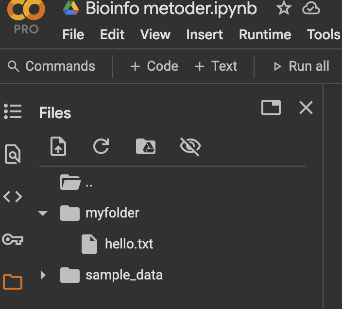
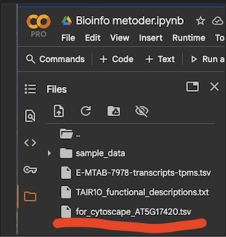

# How this workbook works

Everything in this module runs **in your web browser** — there is nothing to install
except Cytoscape in week 2. The code runs in **Google Colab**, a free online notebook
where Google lends you a small Linux computer with Python already set up.

1. Go to [colab.research.google.com](https://colab.research.google.com), sign in with
   a Google account and click **New notebook**. Give it a name you will recognise
   (e.g. `M4Ø1_yourname`).
2. Every grey code block on this page goes into **one Colab code cell**: hover over the
   block, click the copy icon in its top-right corner, paste it into a cell and press
   **Shift + Enter** to run it.
3. Lines that start with **`!`** are **Linux commands** — Colab runs them in its shell
   instead of in Python. Leave the `!` in place; it is part of the code.

Some steps end with a *Your turn* question and a folded **Answer** — try it before you
unfold.

::: {.callout-important title="Colab forgets everything when it disconnects"}
The Colab computer is temporary. If you close the tab, sit idle for a while, or come
back the next day, the session is reset: **all downloaded files and all variables are
gone**. That is why each session below starts with a **setup block** that re-creates
everything it needs. If you ever see `NameError: name 'df_unique' is not defined` or
`No such file or directory`, scroll up to the session's setup block and run it again.
Anything you want to keep (e.g. the network files in Sessions 5–6) you must
**download to your own computer**.
:::

Three kinds of boxes appear besides plain code:

::: {.run-local}
Files and setup — what to download, where it goes, and what to rerun after a reset.
:::

::: {.web}
Work done on a database website (UniProt, Expression Atlas, ePlant, STRING …), not in
Colab.
:::

::: {.terminal}
Work done in the Cytoscape desktop program on your own computer.
:::

::: {.provenance}
All analyses use public *Arabidopsis thaliana* data. Session 1 downloads raw reads
from the Sequence Read Archive (BioProject PRJNA314076, the Klepikova et al. 2016
developmental atlas). Sessions 2–6 use the processed version of an Arabidopsis
organ atlas from the **EBI Expression Atlas** (experiment **E-MTAB-7978**: 56 RNA-seq
samples from 23 organs and tissues, TPM values), gene descriptions from **TAIR10**,
and protein–protein interactions from **BioGRID** (release 5.0.250). Everything is
downloaded straight from the source inside your Colab session.
:::

---

# Schedule {#sec-schedule}

Module 4 runs over two weeks, Tuesday and Thursday mornings, plus Thursday afternoons
— taught by **Marek Mutwil** ([mutwil@plen.ku.dk](mailto:mutwil@plen.ku.dk)). The
**Section** column links to the part of this page that goes with each block.

::: {.schedule}
| Date | Time | What happens | Slides / materials | Section |
|:--|:--|:--|:--|:--|
| **Week 43**<br>**Tue 20-10**<br>09:00–12:00 | 09:00–09:50 | Lecture **M4F1**: Transcriptomics — background and theory | `M4F1 - Transcriptomics Background and theory.pdf` | |
| | 09:50–10:05 | *Break* | | |
| | 10:05–10:20 | Lecture **M4F2**: Normalization metrics in RNA-seq | `M4F2 - Normalization metrics in RNA-seq.pdf` | |
| | 10:20–12:00 | Exercise **M4Ø1**: Colab basics and estimating gene expression with kallisto | this workbook | [§1](#sec-o1) |
| **Thu 22-10**<br>09:00–12:00<br>13:00–16:00 | 09:00–10:15 | Lecture **M4F3**: Exploratory data analysis (EDA) and data preprocessing | | |
| | 10:15–10:30 | *Break* | | |
| | 10:30–12:00 | Exercise **M4Ø2**: EDA and preprocessing | this workbook | [§2](#sec-o2) |
| | 12:00–13:00 | *Lunch* | | |
| | 13:00–13:55 | Lecture **M4F4**: Basic transcriptomics analyses and online databases | | |
| | 13:55–14:10 | *Break* | | |
| | 14:10–15:00 | Exercise **M4Ø3**: Co-expression analysis | this workbook | [§3](#sec-o3) |
| | 15:00–15:15 | *Break* | | |
| | 15:15–16:00 | Exercise **M4Ø4**: Transcriptomic databases | this workbook | [§4](#sec-o4) |
| **Week 44**<br>**Tue 27-10**<br>09:00–12:00 | 09:00–10:00 | Lecture **M4F5**: Biological networks | `M4F5 - BiologicalNetworks.pdf` | |
| | 10:00–12:00 | Exercise **M4Ø5**: Co-expression network analysis in Cytoscape | this workbook · [Cytoscape](https://cytoscape.org/download.html) | [§5](#sec-o5) |
| **Thu 29-10**<br>09:00–12:00<br>13:00–16:00 | 09:00–09:15 | Lecture **M4F6**: Multi-omic network analysis of secondary cell wall biosynthesis | `M4F6 - NetworkProject.pptx`<br>`secondary cell wall regulation.pdf` | [§6](#sec-project) |
| | 09:30–12:00 | Mini-project, and finishing your presentation | this workbook | [§6](#sec-project) |
| | 12:00–13:00 | *Lunch* | | |
| | 13:00–13:55 | **Peer review** of the mini-project presentations | | [§6.8](#sec-present) |
| | 13:55–14:05 | *Break* | | |
| | 14:05–16:00 | Q&A session (*spørgetime*) | | |
:::

The time plan is tentative and may be adjusted during teaching; Absalon is the
authority if anything changes.

**Reading**, to be done *before* the session it belongs to (all on Absalon):

- Tuesday, week 43 — `transcriptomic_databases_plants.pdf`; *TPM vs RPKM explained*
- Thursday, week 43 — `co-expression analysis.pdf`, `bulk atlas.pdf`, `cell atlas.pdf`
- Thursday, week 44 — `secondary cell wall regulation.pdf` (you will also feed this
  review to an AI model in [§6.3](#sec-grn))

::: {.provenance}
The block-by-block times and readings are those of the 2025 *Modul 4 ugeplan*. The
2026 dates assume the module keeps its slot (weeks 43–44, Tuesday + Thursday).
:::

---

# Session M4Ø1 — Colab basics and estimating gene expression with kallisto {#sec-o1}
[Tuesday, week 43]{.session-chip}

Today has two halves. First you learn just enough Colab — text cells, Python cells and
Linux commands — to work through the module. Then you do what every RNA-seq project
starts with: download raw sequencing reads and turn them into **gene expression
values** with *kallisto*.

## 1.1 Colab basics: text cells

Colab notebooks mix **text cells** (notes, written in *Markdown*) with **code cells**.
Click **+ Text** at the top of the notebook and type:

```markdown
# My first Markdown cell
This is **bold**, this is *italic*, and here is a list:
- Item 1
- Item 2

You can also add [links](https://colab.research.google.com).
```

Press **Shift + Enter** — the cell renders as formatted text.

*Your turn:* make a text cell with a level-2 heading "Colab Basics", one sentence
explaining what you will learn this week, and a numbered list of three learning goals.

::: {.callout-tip collapse="true" title="Answer"}
```markdown
## Colab Basics
This week I learn how to turn raw RNA-seq reads into expression values and analyse them.

1. Run code and Linux commands in Colab
2. Estimate gene expression with kallisto
3. Explore an expression matrix (EDA) and find co-expressed genes
```
A level-2 heading has **two** `#` signs; numbered lists just start each line with `1.`,
`2.`, `3.`.
:::

## 1.2 Colab basics: running Python

Code cells run Python by default. Click **+ Code**, paste, and run:

```python
print("Hello from Python!")
x = 5
y = 7
print("Sum:", x + y)
```

`x` and `y` are variable *names*; `5` and `7` are their *values*.

*Your turn:* write a cell that creates a variable `my_name` holding your first name and
prints `Hello, my name is ...` using that variable.

::: {.callout-tip collapse="true" title="Answer"}
```python
my_name = "Andreas"
print("Hello, my name is", my_name)
```
:::

Learning proper Python is not a goal of this course — but you should be able to
**read** and **modify** existing Python code to run a transcriptomic analysis. That is
exactly what the rest of the module asks of you.

## 1.3 Colab basics: Linux commands

Colab runs on **Linux**, so you can run shell commands from a notebook by starting the
line with `!`. Run each of these in its own cell:

```python
# 1. Show where you are (print working directory)
!pwd
```

```python
# 2. List the files in the current directory
!ls
```

```python
# 3. Create a folder and check that it exists
!mkdir myfolder
!ls
```

```python
# 4. Create a file with some text in it, then show its contents
!echo "Hello from Linux" > myfolder/hello.txt
!cat myfolder/hello.txt
```

The new folder and file also appear in the **Files** panel (the folder icon on the
left). Click the file to open it:

{.shot width=60%}

*Your turn:* (1) make a folder called `testdir`; (2) inside it, create a file
`note.txt` containing the text *This is my note*; (3) list the files in `testdir` to
confirm it worked.

::: {.callout-tip collapse="true" title="Answer"}
```python
!mkdir testdir
!echo "This is my note" > testdir/note.txt
!ls testdir
!cat testdir/note.txt
```
`echo "..." > file` writes the text into the file. (`!touch testdir/note.txt` would
also create the file — but empty, without the text.)
:::

## 1.4 Install kallisto

**Background:** gene expression can be approximated by measuring how much mRNA a gene
makes. RNA-seq does this by converting mRNA into [cDNA](https://www.youtube.com/watch?v=-kTcFZxP6kM&t=663s)
(watch 8:10–10:10) and reading it with
[short-read sequencing](https://www.youtube.com/watch?v=fCd6B5HRaZ8&t=243s). Counting how
many reads come from each gene tells you how highly it is expressed relative to the
other genes.

*kallisto* is the program that does the counting. Install it with Linux commands:

```python
# Download kallisto v0.46.0
!wget -q https://github.com/pachterlab/kallisto/releases/download/v0.46.0/kallisto_linux-v0.46.0.tar.gz
# Unpack the archive
!tar -xf kallisto_linux-v0.46.0.tar.gz
# Install it by copying the program into a folder where Linux looks for programs
!cp kallisto/kallisto /usr/local/bin/
# Run the program and ask for its version
!kallisto version
```

To see which commands and parameters kallisto takes, run it without any:

```python
!kallisto
```

## 1.5 Download the Arabidopsis coding sequences

kallisto needs the **sequences of all transcripts** of your organism — here the coding
sequences (CDS) of *Arabidopsis thaliana* — to build an *index*. The index lets
kallisto match RNA-seq reads to transcripts in a very time- and memory-efficient
way, which is what made it so popular.

```python
# Coding sequences of the representative gene model of every Arabidopsis gene (TAIR10)
!wget -q -O TAIR10_cds.fa "https://www.arabidopsis.org/api/download-files/download?filePath=Genes/TAIR10_genome_release/TAIR10_blastsets/TAIR10_cds_20110103_representative_gene_model_updated"
print("CDS file downloaded")

# Inspect the first lines of the file
!head TAIR10_cds.fa
```

kallisto does **pseudoalignment**: instead of aligning every read base by base, it
looks up which transcripts each read *could* come from. For that it cuts the
transcriptome into short words of length *k* (*k*-mers, by default k = 31) and builds
a lookup table — for every *k*-mer, which transcripts contain it.

## 1.6 Build the kallisto index

`kallisto index` builds that lookup table. After `-i` you give the name of the
**index file to create**, followed by the **FASTA file to read**:

```python
!kallisto index -i TAIR10_index.idx TAIR10_cds.fa
```

This takes a few minutes. Read on while it runs.

## 1.7 The Sequence Read Archive (SRA)

With the index built, we need raw RNA-seq reads. There is a vast amount of public data
in the **Sequence Read Archive (SRA)**, which stores raw reads from RNA-seq and every
other kind of sequencing experiment — from individual labs as well as from large
efforts such as ENCODE or AtGenExpress.

::: {.web}
Go to the SRA at [ncbi.nlm.nih.gov/sra](https://www.ncbi.nlm.nih.gov/sra), search for
**PRJNA314076** and click **Send results to Run selector**.

An SRA project acts as a container for several kinds of accession: **SRP** records hold
project metadata; **SRX** records describe the platform, library and processing of one
sequencing e**X**periment; **SRR** records hold the actual **R**eads (these files can be
huge, with millions of reads); **SRS** records describe the **S**ample; and **SRZ**
records are for aligned (BAM) files.

Look at the record **SRR3581356**:

a. Which tissue does the sample represent?
b. How many samples were sequenced for this tissue?
c. How many reads (spots) does the run contain?
d. Which sequencing platform was used?
e. Look at the BioProject. What kinds of comparisons can be made between the samples?
f. How long are the reads?
:::

::: {.callout-tip collapse="true" title="Answer"}
a. **Root.**
b. **2** (two replicates).
c. About **25 million** reads (25,220,183).
d. **Illumina HiSeq 2000.**
e. The samples form a **tissue and organ atlas** of Arabidopsis development — you can
   compare expression between organs and developmental stages, and use the whole set
   for co-expression analysis.
f. **50 bases** (single-end).
:::

## 1.8 Download reads for two organs

We will look at **cellulose synthase 4** (*CESA4*), which makes cellulose — the most
abundant polymer on Earth — in plant secondary cell walls. Download one sample each
from a mature **leaf** and a stem **internode**, plus a third sample that will
demonstrate something.

```python
# SRA toolkit, which contains fasterq-dump for downloading reads
!apt-get -qq install -y sra-toolkit
!mkdir -p sra_fastq

# Leaf, mature (L.lg)
!fasterq-dump SRR3581681 -O sra_fastq
# Internode (IN)
!fasterq-dump SRR3581705 -O sra_fastq
# And another sample, to demonstrate something :)
!fasterq-dump SRR34314723 -O sra_fastq

# Show the downloaded files
!ls -lh sra_fastq
```

The two Arabidopsis files are about **6 GB each** — expect the downloads to take
several minutes. Run `!fasterq-dump` without arguments if you are curious about its
many options; the defaults are fine for us.

Look at the first reads of one file:

```python
!head -8 sra_fastq/SRR3581681.fastq
```

This format should look familiar — it is FASTQ, covered in the first weeks of the
course: four lines per read (name, sequence, `+`, quality string).

## 1.9 Quantify expression with kallisto

We now have all three ingredients:

1. FASTQ files with the sequenced reads;
2. the coding sequences of the organism, turned into a kallisto index;
3. the software (kallisto) that combines 1 and 2 into expression values.

`kallisto quant` needs to know the index (`-i`), an output folder (`-o`) and the FASTQ
file. These reads are **single-end** (each fragment was read from one end only), so
kallisto cannot measure fragment lengths itself — we give it the typical library
fragment length and its standard deviation with `--single -l 200 -s 20`. (For
paired-end data, which is most data today, you leave these out.)

```python
!kallisto quant -i TAIR10_index.idx -o SRR3581681/ sra_fastq/SRR3581681.fastq --single -l 200 -s 20
!kallisto quant -i TAIR10_index.idx -o SRR3581705/ sra_fastq/SRR3581705.fastq --single -l 200 -s 20
!kallisto quant -i TAIR10_index.idx -o SRR34314723/ sra_fastq/SRR34314723_1.fastq --single -l 200 -s 20
```

This runs for a few minutes per sample.

## 1.10 kallisto's output files

Each output folder contains three files:

| File | Format | What it is | Use it for |
|:--|:--|:--|:--|
| `abundance.tsv` | text table | one row per transcript: `target_id`, `length`, `eff_length` (length adjusted for fragment size), `est_counts` (estimated reads), `tpm` (transcripts per million) | expression results, plotting, downstream analysis |
| `abundance.h5` | binary (HDF5) | the same abundances plus bootstraps and metadata | downstream tools such as *sleuth* |
| `run_info.json` | text (JSON) | how the run went: command, number of reads, versions | quality control and reproducibility |

Open each folder in the Files panel and look at the `run_info.json` files (or print
them with `!cat SRR3581681/run_info.json`). What does each line mean? The
[kallisto manual](https://pachterlab.github.io/kallisto/starting) helps.

::: {.callout-tip collapse="true" title="Answer"}
- `n_targets` — number of transcripts in the index (what kallisto can map to)
- `n_bootstraps` — number of bootstrap resamplings (0 here: none done)
- `n_processed` — number of reads processed from the FASTQ file
- `n_pseudoaligned` — reads that pseudoaligned to at least one transcript
- `n_unique` — reads assigned unambiguously to a single transcript
- `p_pseudoaligned` / `p_unique` — the same two as percentages of `n_processed`
- `kallisto_version` / `index_version` — versions used (reproducibility)
- `start_time`, `call` — when the run started and the exact command used
:::

*Your turn:* one sample has problems. Which one? Could you already have spotted it in
kallisto's console output above? What do you think is wrong with it?

::: {.callout-tip collapse="true" title="Answer"}
**SRR34314723.** kallisto's own output already says it:
`processed 30 reads, 6 reads pseudoaligned` — only **30 reads** in total, and only 20 %
of them map. A real sample has millions of reads with most of them mapping (the leaf
sample: 17.4 of 25.7 million).

Look the run up in the SRA and the reason is clear: it is a tiny paired-end test run
from **rice and sorghum** seedlings — the wrong organism for an Arabidopsis index, and
far too shallow to say anything. The lesson: always check `run_info.json` (or the
console) before you trust a sample, and check the metadata of anything you download.
:::

## 1.11 Is CESA4 expressed where you would expect?

Secondary cell walls are thick, cellulose-rich walls laid down in cells that need
mechanical strength — the vasculature of stems (internodes) and roots. Read the two
`abundance.tsv` files and pull out CESA4:

```python
import pandas as pd

# Paths to the two abundance files
files = {
    "Leaf": "SRR3581681/abundance.tsv",
    "Internode": "SRR3581705/abundance.tsv"
}

# Transcript ID of CESA4 in Arabidopsis
cesa4_id = "AT5G44030.1"

cesa4_expr = {}
for sample, path in files.items():
    df = pd.read_csv(path, sep="\t")
    # kallisto reports transcripts in the 'target_id' column
    match = df[df["target_id"].str.contains(cesa4_id, case=False)]
    cesa4_expr[sample] = match["tpm"].sum()   # sum, in case several transcripts match

cesa4_df = pd.DataFrame.from_dict(cesa4_expr, orient="index", columns=["TPM"])
print(cesa4_df)
```

*Your turn:* does the expression of CESA4 match its function?

::: {.callout-tip collapse="true" title="Answer"}
Yes. CESA4 is at about **2 TPM** in the leaf but about **147 TPM** in the internode —
roughly 60 times higher. Stems are full of vascular tissue with secondary cell walls,
leaves much less so, so a secondary-wall cellulose synthase should be highest in the
internode.
:::

---

# Session M4Ø2 — EDA and preprocessing {#sec-o2}
[Thursday, week 43 · morning]{.session-chip}

In Session 1 you made expression values and used `run_info.json` to catch a bad
sample. But samples can look fine in their run statistics and still be problematic —
and one bad sample can ruin every analysis downstream. **Exploratory data analysis
(EDA)** is the first systematic look at an expression matrix, used to:

- check data quality;
- understand the overall patterns;
- find problems *before* the formal analyses (differential expression, co-expression…).

## 2.1 Download and load the expression matrix

In Session 1 you processed two samples of the Klepikova developmental atlas by hand.
Now we download a whole processed atlas — a **TPM matrix** with every gene in every
sample — from the EBI Expression Atlas, together with the **SDRF** sample annotation
file that says which organ each sample came from.

::: {.run-local}
This block is also the **setup block** for Session 2 — rerun it (then §2.1's second
block) if Colab has reset.
:::

```python
import pandas as pd

# The expression matrix (TPM values) and the sample annotation file
!wget -q -O E-MTAB-7978-transcripts-tpms.tsv https://ftp.ebi.ac.uk/pub/databases/microarray/data/atlas/experiments/E-MTAB-7978/E-MTAB-7978-transcripts-tpms.tsv
!wget -q -O E-MTAB-7978.sdrf.txt https://ftp.ebi.ac.uk/pub/databases/microarray/data/atlas/experiments/E-MTAB-7978/E-MTAB-7978.sdrf.txt

# Load the sample metadata and map each sequencing run (ERR...) to its organ
meta = pd.read_csv("E-MTAB-7978.sdrf.txt", sep="\t")
sample_to_organ = meta[["Comment[ENA_RUN]", "Characteristics[organism part]"]].drop_duplicates()
sample_to_organ_dict = sample_to_organ.set_index("Comment[ENA_RUN]")["Characteristics[organism part]"].to_dict()

# Preview the first five run -> organ pairs
list(sample_to_organ_dict.items())[:5]
```

Now load the matrix and replace the run IDs by organ names:

```python
import pandas as pd

# 1. Load the TPM expression matrix
df = pd.read_csv("E-MTAB-7978-transcripts-tpms.tsv", sep="\t")

# 2. Keep only the primary transcript of each gene (transcript ID ends with ".1")
df = df[df["GeneID"].str.endswith(".1")].copy()

# 3. Sample columns are named after their run (ERR...); rename them to organ names
df_renamed = df.copy().fillna(0)
df_renamed.rename(columns=sample_to_organ_dict, inplace=True)

# 4. Drop the columns we do not need; keep "Gene ID" + one column per sample
df_renamed = df_renamed.drop(columns=["Gene Name", "GeneID"], errors="ignore")

# 5. Show the first rows
df_renamed.head()
```

Genes are in rows (e.g. AT1G01010) and the **56 samples** in columns. Several organs
were sampled more than once, so the same organ name appears in several columns — these
are the biological replicates.

## 2.2 How many genes are expressed?

There is no hard rule for when to call a gene "expressed", but a common choice is
**TPM > 1 in at least one sample**:

```python
# TPM threshold for calling a gene expressed
threshold = 1.0

# True for every gene (row) that is above the threshold in at least one sample.
# axis=1 looks along rows; axis=0 would look along columns.
expressed_mask = (df_renamed.iloc[:, 1:] > threshold).any(axis=1)
expressed_genes = df_renamed[expressed_mask]

print(f"{df_renamed.shape[0]} genes are present in the original expression matrix.")
print(f"{expressed_genes.shape[0]} genes are expressed at TPM > {threshold} in at least one sample.")
print("Thus, we removed", df_renamed.shape[0] - expressed_genes.shape[0], "lowly expressed genes.")
```

*Your turn:* change the threshold to 10 and then 100. What happens? Is this expected?

::: {.callout-tip collapse="true" title="Answer"}
| threshold | expressed genes (of 27,619) |
|:--|:--|
| TPM > 1 | 25,835 |
| TPM > 10 | 21,305 |
| TPM > 100 | 7,323 |

The number drops as the threshold rises — expected, since a stricter cutoff rejects
more genes. Note how *most* genes clear TPM > 1 somewhere: with 56 samples from 23
organs, nearly every gene is switched on in at least one place.
:::

## 2.3 Distributions: why log₂(TPM + 1)?

Before any comparison between samples, look at the **distribution** of expression
values in each sample. TPM values are extremely skewed — a few genes are expressed
thousands of times higher than the rest. Plot the raw values first:

```python
import numpy as np
import matplotlib.pyplot as plt
import seaborn as sns

# Only the numeric sample columns (exclude "Gene ID")
expr_data = df_renamed.iloc[:, 1:]

plt.figure(figsize=(14, 8))
sns.boxplot(data=expr_data, orient="v")
plt.xticks(rotation=90)
plt.ylabel("TPM")
plt.title("Distribution of raw TPM values across samples")
plt.tight_layout()
plt.show()
```

That is pretty useless: a handful of genes with enormous TPM values (the highest, in
seed, is above 100,000) squash every box into a flat line at zero.

Taking **log₂(TPM + 1)** compresses large values and makes the distributions far more
symmetrical; the **+1** lets us take the log of genes with TPM = 0. It is one line of
code:

```python
# Apply log2(TPM + 1) to every value of the matrix
log_expr = np.log2(expr_data + 1)

plt.figure(figsize=(14, 8))
sns.boxplot(data=log_expr, orient="v")
plt.xticks(rotation=90)
plt.ylabel("log₂(TPM + 1)")
plt.title("Distribution of log₂(TPM+1) across samples")
plt.tight_layout()
plt.show()
```

What to look for: **similar shapes** and **aligned medians** across samples mean
comparable data; a sample with an odd shape or a shifted median may have a technical
problem and needs a closer look.

*Your turn:* do you see any outliers?

::: {.callout-tip collapse="true" title="Answer"}
Two organs stand out. **Pollen** has a median of zero — most genes are off and a small,
specialised set of genes takes up nearly all the reads. **Seed** (and to a lesser
extent **stamen**, which contains pollen) has a low median and a long tail of extremely
high values — mature seeds are dominated by a few storage-protein transcripts.

These are not technical failures — they are real biology — but they will dominate any
analysis of the whole matrix, as you are about to see.
:::

The next three plots compare samples with each other:

1. principal component analysis (PCA);
2. a sample distance heatmap;
3. hierarchical clustering of the samples.

## 2.4 PCA

**Principal component analysis (PCA)** reduces thousands of gene expression values per
sample to a few new axes — **principal components (PCs)** — that capture as much of the
variation between samples as possible. Plotting each sample on PC1 and PC2 is the
standard first look at an RNA-seq dataset:

- **sample relationships** — do samples group by organ, treatment or batch?
- **outliers** — samples that do not sit with their biological group;
- **noise reduction** — the first PCs carry the largest sources of variation.

If biological replicates sit together, the experiment is consistent. A sample far away
from everything else may be an outlier worth investigating — and possibly removing.

```python
from sklearn.decomposition import PCA
import matplotlib.pyplot as plt
import seaborn as sns
import pandas as pd

# Numeric values only, samples as rows (.T transposes the matrix)
filtered = df_renamed.apply(pd.to_numeric, errors="coerce").iloc[:, 1:].fillna(0).T

# Make sample names unique (several samples share an organ name)
filtered.index = pd.Series(filtered.index).astype(str)
if not filtered.index.is_unique:
    filtered.index = filtered.index + "_" + pd.Series(range(len(filtered))).astype(str)

# PCA on the raw TPM values
pca = PCA(n_components=2)
pca_result = pca.fit_transform(filtered)
pca_df = pd.DataFrame(pca_result, columns=["PC1", "PC2"], index=filtered.index)

# Plot, with each sample labelled
plt.figure(figsize=(10, 7))
sns.scatterplot(data=pca_df, x="PC1", y="PC2", s=100)
for sample_id in pca_df.index:
    x, y = pca_df.loc[sample_id]
    plt.text(x + 0.2, y, str(sample_id), fontsize=9)
plt.title("PCA of RNA-seq samples (raw TPM)")
plt.xlabel(f"PC1 ({pca.explained_variance_ratio_[0]*100:.1f}%)")
plt.ylabel(f"PC2 ({pca.explained_variance_ratio_[1]*100:.1f}%)")
plt.grid(True)
plt.tight_layout()
plt.show()
```

*Your turn:* what does the plot look like? Why — and what should be improved to make
it useful?

::: {.callout-tip collapse="true" title="Answer"}
Pretty bad: the **seed** samples are pulled far out along PC1 and everything else is
lumped together in one corner. On raw TPM the PCA is driven by the few genes with
gigantic values — exactly the seed storage-protein genes from §2.3 — so the plot shows
"seed vs. the rest" and nothing else. We need to tame the extreme values (log) and stop
a few genes from dominating (filtering, scaling). We fix this in §2.7.
:::

## 2.5 Sample distance heatmap

A sample distance heatmap shows how different every sample is from every other sample,
with the samples reordered by clustering so that similar samples sit next to each other.
Functions like these have many parameters you can tweak — the
[distance metric](https://docs.scipy.org/doc/scipy/reference/generated/scipy.spatial.distance.pdist.html)
and the [colour palette](https://seaborn.pydata.org/tutorial/color_palettes.html), for
example.

```python
from scipy.spatial.distance import pdist, squareform
import seaborn as sns
import matplotlib.pyplot as plt

# Pairwise Euclidean distances between samples
distance_matrix = pd.DataFrame(
    squareform(pdist(filtered, metric="euclidean")),
    index=filtered.index,
    columns=filtered.index
)

# Heatmap, with samples clustered on both axes
sns.clustermap(distance_matrix, cmap="viridis", figsize=(16, 16))
plt.title("Sample Distance Heatmap")
plt.show()
```

(A `ClusterWarning` about an "uncondensed distance matrix" may appear — it is harmless.)

*Your turn:*

- change `metric="euclidean"` to `"correlation"`;
- change `cmap="viridis"` to `"plasma"`;
- which samples cluster together — replicates of the same organ, or different organs?

::: {.callout-tip collapse="true" title="Answer"}
Many replicates do sit together — the rosette leaves, the flowers, the roots — but the
picture is dominated by the **seed** samples, which form their own extreme block, and
the remaining organs are poorly resolved. Switching to `"correlation"` compares the
*shape* of the profiles rather than their absolute size, yet on raw TPM it barely helps:
a Pearson correlation of raw values is itself driven by the few genes with enormous
values. The colour map changes only the look, not the result. The real fix is
preprocessing (§2.7).
:::

## 2.6 Hierarchical clustering of samples

Sometimes you only want to see how the samples cluster, without the heatmap — that is a
**dendrogram**:

```python
from scipy.cluster.hierarchy import linkage, dendrogram

# Hierarchical clustering (Ward's method)
Z = linkage(filtered, method="ward")

plt.figure(figsize=(12, 6))
dendrogram(Z, labels=filtered.index, leaf_rotation=90)
plt.title("Hierarchical Clustering of RNA-seq Samples")
plt.ylabel("Distance")
plt.tight_layout()
plt.show()
```

*Your turn:* change `method="ward"` to `"average"`, `"complete"` or `"single"`. How
does the method change the clustering? Do samples from the same organ cluster together —
does it match known biology?

::: {.callout-tip collapse="true" title="Answer"}
Largely yes: replicates of the same organ (the many rosette leaves, the flowers, the
siliques, the roots) end up in the same branches. But look at the very first split:
five **seed** samples on one side, all 51 other samples on the other — the seeds'
extreme values again dominate. The linkage method changes
the tree noticeably — `single` linkage tends to "chain" samples one at a time onto a
growing cluster, while `ward` and `complete` give compact, balanced groups. There is no
single correct method; a grouping that survives several methods is more trustworthy.
:::

## 2.7 Preprocessing

The data looked not great but not terrible — many expected samples grouped together.
We can do better with **preprocessing**, which typically has four steps:

1. **Filter out lowly expressed genes.** Genes that are barely expressed add noise. A
   common rule: keep genes with TPM > 1 in at least half of the samples.
2. **(Optional) keep the most variable genes.** PCA works best on the genes that
   actually differ between samples — e.g. the top 5,000 by variance.
3. **Log-transform** — log₂(TPM + 1), as in §2.3.
4. **Standardise** each gene to mean 0 and variance 1, so that every gene contributes
   equally and highly expressed genes cannot dominate.

This improves the clustering and interpretability of PCA plots, helps you spot real
outliers and batch effects, and focuses the analysis on biologically relevant variation.

The code below does the four steps in order. You can switch a step off by changing its
`if True:` to `if False:`.

```python
import pandas as pd
import numpy as np
from sklearn.preprocessing import StandardScaler
from sklearn.decomposition import PCA
import matplotlib.pyplot as plt
import seaborn as sns

# Only the numeric expression columns
expression_data = df_renamed.iloc[:, 1:]
# A unique name for each sample: organ_number
sample_names = [f"{name}_{i}" for i, name in enumerate(expression_data.columns, start=1)]

if True:  # Step 1. Filter out lowly expressed genes
    min_samples = expression_data.shape[1] // 2   # half of the samples
    expression_data = expression_data[(expression_data > 1).sum(axis=1) >= min_samples]

if True:  # Step 2. Keep the top 5,000 most variable genes
    top_n = min(5000, expression_data.shape[0])
    expression_data = expression_data.loc[expression_data.var(axis=1).nlargest(top_n).index]

if True:  # Step 3. log2(TPM + 1)
    expression_data = np.log2(expression_data + 1)

if True:  # Step 4. Standardise each gene (samples as rows, so we transpose)
    expression_data_transposed = StandardScaler().fit_transform(expression_data.T)
else:
    expression_data_transposed = expression_data.T

# PCA
pca = PCA(n_components=2)
pca_result = pca.fit_transform(expression_data_transposed)
pca_df = pd.DataFrame(pca_result, columns=["PC1", "PC2"], index=sample_names)

plt.figure(figsize=(10, 7))
sns.scatterplot(data=pca_df, x="PC1", y="PC2", s=100)
for sample_id in pca_df.index:
    plt.text(float(pca_df.loc[sample_id, "PC1"]) + 0.2,
             float(pca_df.loc[sample_id, "PC2"]), str(sample_id), fontsize=9)
plt.title("PCA of RNA-seq samples (preprocessed)")
plt.xlabel(f"PC1 ({pca.explained_variance_ratio_[0]*100:.1f}%)")
plt.ylabel(f"PC2 ({pca.explained_variance_ratio_[1]*100:.1f}%)")
plt.grid(True)
plt.tight_layout()
plt.show()
```

*Your turn:* how does the PCA compare to §2.4? Then switch the steps off one at a time —
which step makes the biggest difference?

::: {.callout-tip collapse="true" title="Answer"}
With 56 samples the plot is still busy, but it is a big improvement: the samples now
spread out over both PCs and organs form recognisable groups instead of "seed vs. the
rest". The **log transform** (step 3) makes the largest difference — switch it off and
the extreme genes take over again. The filter in step 1 keeps 15,089 genes; step 2
then narrows them to the 5,000 most variable.
:::

Now rerun the sample distance heatmap from §2.5, this time on the preprocessed data:

```python
from scipy.spatial.distance import pdist, squareform

# Samples as rows, genes as columns
X = expression_data.T.astype("float32")

distance_matrix = pd.DataFrame(
    squareform(pdist(X, metric="euclidean")),
    index=X.index,
    columns=X.index
)

sns.clustermap(distance_matrix, cmap="viridis", figsize=(16, 16))
plt.title("Sample Distance Heatmap (preprocessed)")
plt.show()
```

*Your turn:* do you see an improvement?

::: {.callout-tip collapse="true" title="Answer"}
Yes — the groups are much clearer than before. For example, the flower samples now
cluster together instead of being scattered, and the leaf samples form one block.
:::

And the dendrogram:

```python
from scipy.cluster.hierarchy import linkage, dendrogram

Z = linkage(expression_data.T, method="ward")

plt.figure(figsize=(12, 6))
dendrogram(Z, labels=filtered.index, leaf_rotation=90)
plt.title("Hierarchical Clustering of RNA-seq Samples (preprocessed)")
plt.ylabel("Distance")
plt.tight_layout()
plt.show()
```

*Your turn:* is the dendrogram clearer? What has changed?

::: {.callout-tip collapse="true" title="Answer"}
Same story as the heatmap: samples are far less scattered. The rosette leaves sit in
one branch, flowers and siliques in neighbouring branches, roots with root tips and
callus, and most seeds together. Pollen joins two of the seed samples — both are
dominated by a small set of very specialised transcripts.
:::

---

# Session M4Ø3 — Co-expression analysis {#sec-o3}
[Thursday, week 43 · afternoon]{.session-chip}

## 3.1 What is co-expression?

Proteins that work together — for example in a protein complex — must all be present
in the right amounts at the same time. Their mRNA levels therefore tend to be
[correlated](https://en.wikipedia.org/wiki/Correlation_and_dependence): they rise and
fall together across the life of the organism. Genes whose mRNA levels are correlated
are **[co-expressed](https://en.wikipedia.org/wiki/Gene_co-expression_network)**, and
co-expression is a powerful way to find **functionally related genes** — in plants,
bacteria, animals and fungi alike.

We measure co-expression with the **Pearson correlation coefficient (PCC, *r*)**: +1
for a perfect positive correlation, 0 for none, −1 for a perfect negative one.

To build intuition, here are five made-up genes, A–E, measured in six samples. Compare
gene A with each of the others:

```python
import pandas as pd
from scipy.stats import pearsonr

df = pd.DataFrame({
    "A": [1, 2, 3, 4, 5, 6],        # our query gene A
    "B": [10, 11, 12, 13, 14, 15],  # perfectly correlated with A
    "C": [5, 6, 7, 5, 9, 10],       # well correlated, but the 4th value (5) is a minor outlier
    "D": [9, 5, 12, 10, 7, 9],      # not correlated with A at all
    "E": [10, 11, 12, 0, 14, 15]    # like B, but the 4th value (0) is a major outlier
})

for g in ["B", "C", "D", "E"]:
    r, p = pearsonr(df["A"], df[g])   # PCC of A vs. the other gene, and its p-value
    print(f"A ↔ {g}:  r = {r: .3f}   (p = {p:.2e})")
```

A and B are perfectly correlated: *r* = 1, and the p-value (the probability of seeing
such a correlation by chance) is 0. Plot A against each gene, with a regression line,
to see how the points produce the PCC:

```python
import matplotlib.pyplot as plt
import seaborn as sns

genes = ["B", "C", "D", "E"]
fig, axs = plt.subplots(1, 4, figsize=(18, 4), sharex=True, sharey=True)
for ax, g in zip(axs, genes):
    sns.regplot(x="A", y=g, data=df, scatter_kws={"s": 80, "alpha": 0.8},
                line_kws={"color": "red"}, ci=None, ax=ax)
    r, _ = pearsonr(df["A"], df[g])
    ax.set_title(f"A ↔ {g}\nPCC = {r:.2f}")
    ax.set_xlabel("Gene A")
    ax.set_ylabel(f"Gene {g}")
plt.tight_layout()
plt.show()
```

*Your turn:* what can you say about genes C, D and E and their relationship to A? Are
outliers a serious problem? How could you deal with them?

::: {.callout-tip collapse="true" title="Answer"}
- **B**: *r* = 1.00 — every point is on the line.
- **C**: *r* = 0.82 (p = 0.048) — strongly correlated, except for one slightly-off value.
- **D**: *r* = 0.09 — no relationship with A at all.
- **E**: *r* = 0.22 — E follows A perfectly in five of six samples, yet a **single
  outlier** drags the PCC from 1 down to 0.22.

So yes, outliers are a serious problem for PCC: one bad sample can hide a real
relationship (E) or create a fake one. Remedies: remove the offending sample (after
EDA has identified it, as in Session 2), log-transform the data to shrink extreme
values, or use a rank-based correlation (Spearman) that is less sensitive to single
values.
:::

## 3.2 The expression matrix, annotated with gene functions

Now let's see whether the real expression matrix can predict gene function. We need the
atlas again — this time with a **description** for every gene, from TAIR.

::: {.run-local}
This is the **setup block** for Session 3. Run it even if you still have Session 2's
variables — it builds a different table (`df_unique`).
:::

```python
# Expression data, sample annotation, and TAIR gene descriptions
!wget -q -O E-MTAB-7978-transcripts-tpms.tsv https://ftp.ebi.ac.uk/pub/databases/microarray/data/atlas/experiments/E-MTAB-7978/E-MTAB-7978-transcripts-tpms.tsv
!wget -q -O E-MTAB-7978.sdrf.txt https://ftp.ebi.ac.uk/pub/databases/microarray/data/atlas/experiments/E-MTAB-7978/E-MTAB-7978.sdrf.txt
!wget -q -O TAIR10_functional_descriptions.txt "https://www.arabidopsis.org/api/download-files/download?filePath=Genes/TAIR10_genome_release/TAIR10_functional_descriptions"

import pandas as pd

# 1. Sample metadata (SDRF file)
meta = pd.read_csv("E-MTAB-7978.sdrf.txt", sep="\t")

# 2. TAIR descriptions; remove the transcript suffix (.1, .2 ...) to get gene IDs
tair = pd.read_csv("TAIR10_functional_descriptions.txt", sep="\t", dtype=str)
tair["GeneID_clean"] = tair["Model_name"].str.replace(r"\.\d+$", "", regex=True)
tair = tair[["GeneID_clean", "Short_description"]].drop_duplicates(subset=["GeneID_clean"])

# 3. Expression matrix: primary transcripts only, plus a gene ID without suffix
df = pd.read_csv("E-MTAB-7978-transcripts-tpms.tsv", sep="\t")
df = df[df["GeneID"].str.endswith(".1")].copy()
df["GeneID_clean"] = df["GeneID"].str.replace(r"\.\d+$", "", regex=True)

# 4. Map run IDs to organ names
sample_to_organ_dict = (meta[["Comment[ENA_RUN]", "Characteristics[organism part]"]]
                        .drop_duplicates()
                        .set_index("Comment[ENA_RUN]")["Characteristics[organism part]"]
                        .to_dict())

# 5. Rename the sample columns to organ names; missing values become 0
df_renamed = df.copy().fillna(0)
df_renamed.rename(columns=sample_to_organ_dict, inplace=True)

# 6. Keep ONE sample per organ (the first replicate): 23 organs instead of 56 samples
df_unique = df_renamed.loc[:, ~df_renamed.columns.duplicated()]

# 7. Add the TAIR description of each gene
df_unique = df_unique.merge(tair, on="GeneID_clean", how="left")
df_unique = df_unique.drop(columns=["Gene Name", "GeneID", "GeneID_clean"], errors="ignore")

# 8. Save the final matrix
df_unique.to_csv("matrix_unique.txt", sep="\t", index=False)
df_unique
```

`df_unique` has one row per gene: its ID, its expression in 23 organs, and its
description.

## 3.3 Co-expression of a photosynthesis gene

Let's compute the correlation between one gene and **every** other gene in the matrix.
Our query is **PsaK** (AT1G30380, [UniProt](https://www.uniprot.org/uniprotkb/Q9SUI5/entry)),
a subunit of photosystem I. The code finds the gene, computes its PCC with all genes,
and prints the 100 most correlated:

```python
import warnings
import pandas as pd

gene_col = "Gene ID"
desc_col = "Short_description"
target_gene = "AT1G30380"   # replace with your gene of interest

# The expression columns are all columns except the ID and the description
expr_cols = [c for c in df_unique.columns if c not in {gene_col, desc_col}]

# Expression vector of the target gene
target_expr = df_unique.loc[df_unique[gene_col] == target_gene, expr_cols].iloc[0].astype(float)

# PCC of every gene with the target (warnings come from genes with no variation)
with warnings.catch_warnings():
    warnings.simplefilter("ignore", RuntimeWarning)
    pcc = df_unique[expr_cols].astype(float).apply(lambda row: row.corr(target_expr), axis=1)

result_df = pd.DataFrame({gene_col: df_unique[gene_col], desc_col: df_unique[desc_col], "PCC": pcc})

# Sort by PCC and keep the top 100
result_df = result_df.sort_values("PCC", ascending=False).head(100)
result_df["PCC"] = result_df["PCC"].map(lambda x: f"{x:.6f}")
print(result_df.to_string(index=False))
```

*Your turn:* does the function of the top genes correspond to photosynthesis? Are
there any unexpected functions?

::: {.callout-tip collapse="true" title="Answer"}
Yes — the method works very well. The list is dominated by photosynthesis: photosystem I
and II subunits (PsaE, PsaH, PsaF, PsaD, PsaO, PSII subunit P …), light-harvesting
complex proteins and a chloroplast ATP-synthase subunit, all with PCC > 0.97.

Some genes have no known function (e.g. **AT4G01150**, PCC 0.99, description `NaN`).
Because they are so tightly co-expressed with photosynthesis genes, it is very likely
that they also work in photosynthesis — this is how co-expression **predicts the
function of uncharacterised genes** (*guilt by association*). Remember it is a
hypothesis: co-expression is correlation, not proof.
:::

*Your turn:* run the same code for **AT1G14320** and **AT5G22880**. What are their
functions (look them up)? Are they co-expressed with the expected genes?

::: {.callout-tip collapse="true" title="Answer"}
- **AT1G14320** (*SAC52*/RPL10) is a **ribosomal protein**. Its top partners are almost
  all other cytosolic ribosomal proteins (L32e, L23A, S3, L31e, L18ae, …) — the ribosome
  is a huge complex whose parts are made in fixed ratios.
- **AT5G22880** is **histone H2B**. Its partners are other histones (H2A, histone
  superfamily proteins) and DNA-replication factors (RPA70 subunits, replication factor
  A) — all needed in dividing cells, when DNA is copied and packed into new chromatin.

Both behave as expected: co-expression recovers the protein complex or the process each
gene belongs to.
:::

---

# Session M4Ø4 — Transcriptomic databases {#sec-o4}
[Thursday, week 43 · afternoon]{.session-chip}

Let's get to know some popular plant transcriptomic databases. Even if plants are not
your main interest: transcriptomic databases look much the same for animals, fungi,
bacteria and archaea — once you know a few, the rest are easy.

| # | Database | What it holds |
|:--|:--|:--|
| 0 | [UniProt](https://www.uniprot.org/) | protein function, domains, location, literature |
| 1 | [EBI Expression Atlas](https://www.ebi.ac.uk/gxa/home) | bulk RNA-seq: baseline and differential expression |
| 2 | [ePlant](https://bar.utoronto.ca/eplant/) | bulk, tissue and single-cell expression in pictures |
| 3 | [Plant single-cell atlas](http://neomorph.salk.edu:9000/) | single-cell RNA-seq of Arabidopsis |

You will combine a protein-function database with expression databases to study a
developmental regulator, **APETALA3 (AP3)**. AP3 and a handful of other transcription
factors are essential for proper flower development — as its name suggests, the
*ap3-3* mutant (*apetala*) lacks petals (B in the picture):

{.shot width=80%}

## 4.1 UniProt — protein function

UniProt is the central knowledgebase for protein information across all organisms:
functional annotation, domains, sequence, structure, interactions and literature.
Before looking at expression, UniProt is where you find out what a protein does.

::: {.web}
Go to [uniprot.org](https://www.uniprot.org/) and search for **APETALA3** or
**AT3G54340**; pick the *Arabidopsis thaliana* entry.

- Q0.1 What is the annotated function of AP3? Check the associated GO terms.
- Q0.2 Which protein domains does it contain?
- Q0.3 In which subcellular compartment is the protein found?
- Q0.4 Does this fit its biological role as a regulator of flower development?
:::

::: {.callout-tip collapse="true" title="Answer"}
- Q0.1 DNA binding, protein binding, transcriptional activation; flower development
  (specification of petal and stamen identity).
- Q0.2 A **MADS-box** domain (DNA binding) and a **K-box** (protein–protein interaction).
- Q0.3 The **nucleus**.
- Q0.4 Yes — a nuclear, DNA-binding transcription factor is exactly what a regulator of
  flower development should be.
:::

## 4.2 EBI Expression Atlas — bulk RNA-seq

The EBI Expression Atlas holds curated bulk RNA-seq datasets — both *baseline*
experiments (in which tissues is a gene expressed?) and *differential* experiments (how
does expression change between conditions?). It is a good starting point for
tissue-level patterns. (You can also reach it from a gene's UniProt page.)

::: {.web}
Go to [ebi.ac.uk/gxa](https://www.ebi.ac.uk/gxa/home), search for **AT3G54340** and
look at its **baseline** expression across tissues.

- Q1 In which tissues is AP3 expressed most strongly?
- Q2 Which tissues show little or no expression?
- Discuss: why does this pattern make sense for a floral regulator?
:::

::: {.callout-tip collapse="true" title="Answer"}
- Q1 In the **flower** (flower and floral organs).
- Q2 Roots and leaves, among others.
- The gene is expressed where it acts — in flowers — and switched off elsewhere.
:::

## 4.3 ePlant — bulk and tissue expression

ePlant (Bio-Analytic Resource, University of Toronto) integrates many layers of plant
data, with a strong focus on Arabidopsis. It shows expression at the organ and tissue
level and down to single cells, and is especially good for exploring a single gene
visually.

::: {.web}
Go to [ePlant](https://bar.utoronto.ca/eplant/) and search for **AT3G54340**.

1. Click on **Plant eFP viewer**.
   - Q3 Where is expression strongest?
2. Go to **Tissue and Experiment eFP viewers**.
   - Q4 Navigate to the shoot apex viewer. Where is AP3 most highly expressed?
3. Go to the **Navigator viewer** and click on the plant icon for **grape**.
   - Q5 Does AP3 from grape show the expected expression?

*If ePlant is down:* the Bio-Analytic Resource is a university server and is
occasionally offline. Use the EBI Expression Atlas (§4.2) for organ-level expression
instead and come back to ePlant later.
:::

::: {.callout-tip collapse="true" title="Answer"}
- Q3 In the flower — **petals and stamens**, exactly the two organs missing or
  transformed in the *ap3* mutant.
- Q4 In the **UFO** sample.
- Q5 Yes — grape AP3 is also expressed in flowers, so its expression pattern is
  **conserved** across species.
:::

## 4.4 The plant single-cell atlas

The Plant Single Cell Atlas (Salk Institute) holds single-cell RNA-seq data from
Arabidopsis. Genes can be explored across individual cells and cell clusters, showing
exactly where in a tissue — or when in development — a gene is active. That resolution
matters for genes that act in narrow developmental windows.

We switch to **PsaK** (AT1G30380), the photosynthesis gene from §3.3, which is expected
in **mesophyll** cells (the photosynthetic cells of the leaf).

::: {.web}
Go to [neomorph.salk.edu:9000](http://neomorph.salk.edu:9000/) — note the makeshift
address: the database is young, like the whole field of single-cell sequencing.

1. Select the **merged seedling** cell atlas and wait for the page to load.
2. On the right, enter **AT1G30380** in the gene search and click the **water-drop icon**
   to colour the cells by the gene's expression.
3. On the left, identify which clusters show expression.
   - Q6 In which cell types is PsaK most highly expressed?
   - Q7 In which clusters is PsaK most highly expressed?
4. Discuss: are the results very clear? What should the ideal expression of PsaK look
   like?
:::

::: {.callout-tip collapse="true" title="Answer"}
- Q6 **Mesophyll** cells, as expected.
- Q7 **Cluster 12**.
- Not very clear. Ideally PsaK would light up the mesophyll (and other photosynthetic
  cells) and nothing else. Here it is highest in mesophyll, but cluster 12 also contains
  many cells of **unknown type**, and expression is spread more widely than it should
  be. Single-cell data are noisy, and cluster annotation is still incomplete — another
  reason to check results across several databases.
:::

---

# Session M4Ø5 — Co-expression network analysis in Cytoscape {#sec-o5}
[Tuesday, week 44]{.session-chip}

Today you go from **raw transcriptomic data** to a **biological network** that you can
visualise and analyse in Cytoscape.

By the end of this session you will be able to:

- load and preprocess the Arabidopsis expression atlas;
- find the **top 100 genes co-expressed** with a seed gene — **CESA7** (AT5G17420), a
  cellulose synthase of the secondary cell wall;
- build an **all-vs-all co-expression network** among these genes and export it;
- import it into **Cytoscape**, apply layouts, style nodes and edges, and explore
  clusters such as the secondary cell wall module.

Co-expression networks reveal groups of genes that **work together** in a biological
process; combined with network analysis they generate hypotheses about **gene function**
and **regulation**.

::: {.run-local}
**Install Cytoscape before class** on your own computer:
[cytoscape.org/download.html](https://cytoscape.org/download.html) (free; Windows, macOS
and Linux). Start a fresh Colab notebook for today.
:::

## 5.1 Setup: load and preprocess the atlas

This block downloads the atlas and TAIR descriptions, builds gene labels of the form
**`AGI_name`** (e.g. `AT5G17420_CESA7`; `_nan` means the gene has no short name), and
log-transforms and standardises every gene.

```python
import numpy as np
import pandas as pd
from sklearn.preprocessing import StandardScaler

# Expression data and TAIR gene descriptions
!wget -q -O E-MTAB-7978-transcripts-tpms.tsv https://ftp.ebi.ac.uk/pub/databases/microarray/data/atlas/experiments/E-MTAB-7978/E-MTAB-7978-transcripts-tpms.tsv
!wget -q -O TAIR10_functional_descriptions.txt "https://www.arabidopsis.org/api/download-files/download?filePath=Genes/TAIR10_genome_release/TAIR10_functional_descriptions"

# TAIR descriptions, with the transcript suffix (.1, .2 ...) removed
tair = pd.read_csv("TAIR10_functional_descriptions.txt", sep="\t", dtype=str)
tair["Gene ID"] = tair["Model_name"].str.replace(r"\.\d+$", "", regex=True)
tair = tair[["Gene ID", "Short_description"]].drop_duplicates(subset=["Gene ID"])

# Expression matrix: one row per gene (primary transcript), plus its description
df = pd.read_csv("E-MTAB-7978-transcripts-tpms.tsv", sep="\t")
df = df[df["GeneID"].str.endswith(".1")].copy()
df = df.merge(tair, on="Gene ID", how="left")

# Gene label AGI_name, and a lookup table AGI -> label (used in Session 6)
df["Gene_fused"] = df["Gene ID"].astype(str) + "_" + df["Gene Name"].astype(str)
agi2geneName = {k.upper(): v for k, v in zip(df["Gene ID"], df["Gene_fused"])}

# Keep the label, the description and the 56 sample columns
df = df.drop(columns=["Gene ID", "Gene Name", "GeneID"], errors="ignore")
df = df[["Gene_fused"] + [c for c in df.columns if c != "Gene_fused"]]
expr_cols = df.select_dtypes(include=[np.number]).columns

# log2(TPM + 1), then standardise each gene (row) to mean 0 and variance 1
expr_log = np.log2(df[expr_cols] + 1)
expr_scaled = StandardScaler().fit_transform(expr_log.T).T

df_unique = df.copy()
df_unique[expr_cols] = expr_scaled
print(df_unique.shape)
```

## 5.2 The top 100 genes co-expressed with CESA7

The same code as in Session 3 (§3.3), now with CESA7 as the query:

```python
import warnings

gene_col = "Gene_fused"
desc_col = "Short_description"
target_gene = "AT5G17420"   # your gene of interest; here CESA7

# Find the target by the AGI part of its label (before the "_")
mask = df_unique[gene_col].str.split("_").str[0] == target_gene
target_expr = df_unique.loc[mask, expr_cols].iloc[0].astype(float)

# PCC of every gene with the target
with warnings.catch_warnings():
    warnings.simplefilter("ignore", RuntimeWarning)
    pcc = df_unique[expr_cols].astype(float).apply(lambda row: row.corr(target_expr), axis=1)

result_df = pd.DataFrame({gene_col: df_unique[gene_col], desc_col: df_unique[desc_col], "PCC": pcc})
result_df = result_df.sort_values("PCC", ascending=False).head(100)
print(result_df.to_string(index=False))
```

*Your turn:* what do you see in this list? Are the PCC values high, and is there an
expected pattern? Do all genes have known functions?

::: {.callout-tip collapse="true" title="Answer"}
The PCC values are high — from 1 (CESA7 itself) down to about 0.77 for gene 100. And the
pattern is exactly the secondary cell wall: the two other secondary-wall cellulose
synthases **CESA8** and **CESA4** are in the top 5, together with the *IRREGULAR XYLEM*
genes (IRX9, IRX10, IRX12, IRX14, IRX15), xylan-synthesis genes (GUX1, GXM1, GAUT12),
lignin laccases (LAC2, LAC11, LAC17), the chitinase-like CTL2, FASCICLIN-like
arabinogalactan proteins (FLA11, FLA12) — and the transcription factors that control
the whole programme: MYB46, MYB83, MYB103, MYB43, MYB52, MYB85 and the NAC factors
NAC012 (= **SND1**) and NAC073 (= **SND2**).

Not all are known: **36 of the 100** genes have no short name (`_nan`), and several
are described only as *Protein of unknown function (DUFxxx)*. Their co-expression with
the cellulose machinery makes them candidates for new secondary-wall genes.
:::

## 5.3 Your very first co-expression network

Now take these 100 genes and build a co-expression network: compute the PCC between
**every pair** of genes and keep only the pairs (edges) with **PCC > 0.9**.

```python
from itertools import combinations

# 1. The 100 genes
genes = result_df[gene_col].astype(str).tolist()

# 2. Their expression profiles, in the same order
sub = (df_unique[df_unique[gene_col].astype(str).isin(genes)]
       .drop_duplicates(subset=[gene_col])
       .set_index(gene_col)[expr_cols]
       .astype(float))
sub = sub.loc[[g for g in genes if g in sub.index]]

# 3. PCC between every pair of these genes
C = np.corrcoef(sub.values)

# 4. Edge list: every pair with PCC > 0.9 (no self-pairs)
idx = sub.index.to_numpy()
rows = []
for i, j in combinations(range(len(idx)), 2):
    p = float(C[i, j])
    if p > 0.9:
        rows.append((idx[i], idx[j], p))
edges_df = pd.DataFrame(rows, columns=["gene_A", "gene_B", "PCC"]).sort_values("PCC", ascending=False)

# 5. Save it
out_path = f"for_cytoscape_{target_gene}.tsv"
edges_df.to_csv(out_path, sep="\t", index=False)
print(f"Saved {len(edges_df)} edges (PCC > 0.9) among {len(idx)} genes to {out_path}")
```

You should get **195 edges**. Download the network file to your computer from the Files
panel (⋮ next to the file → **Download**):

{.shot width=35%}

## 5.4 Visualise the network in Cytoscape

::: {.terminal}
1. Open the downloaded `for_cytoscape_AT5G17420.tsv` in a text editor first. What is in
   the file, and is it human-readable?
2. Start Cytoscape and import the network: **File → Import → Network from File…**,
   choose the file and click **OK**. Cytoscape guesses that `gene_A` is the source
   node, `gene_B` the target node and `PCC` an edge attribute.

The network is drawn immediately:
:::

{.shot width=70%}

::: {.callout-tip collapse="true" title="Answer: what is in the file?"}
A plain-text, tab-separated table with a header line and one **edge** per line: the two
genes (`gene_A`, `gene_B`) and the PCC between them. It is perfectly human-readable —
a network is just a list of who is connected to whom. Only 57 of the 100 genes appear:
the others have no partner above PCC 0.9.
:::

## 5.5 Annotate the network

Cytoscape makes it easy to change how the network looks. Start by colouring the most
important gene families:

1. CESAs (example below);
2. MYB transcription factors;
3. NAC transcription factors.

::: {.terminal}
1. Select the nodes of one family with the search box at the top right, e.g.
   `name:*cesa*` (then `name:*myb*`, `name:*nac*`).
2. Colour the selected nodes' labels with **Style → Label Color → Bypass**, choosing a
   colour that is easy to read.
:::

{.shot}

*Your turn:* is it easy to tell the four categories (CESA, MYB, NAC, all others) apart?
If not, change the colours so they are easy to distinguish but still pleasant to look
at — for inspiration see the [seaborn palettes](https://seaborn.pydata.org/tutorial/color_palettes.html).
Make the categories even easier to tell apart by giving each one a different
**shape**: repeat the selection and set a shape bypass for each category.

{.shot width=40%}

## 5.6 Change the layout

Cytoscape's layout algorithms decide how the network is arranged on screen. Each one
emphasises different structure — clusters, hubs or linear relationships.

::: {.terminal}
Try at least three layouts from the **Layout** menu:

- force-directed (e.g. **Prefuse Force Directed** or **Edge-weighted Spring Embedded**);
- hierarchical (**Hierarchical Layout**);
- circular (**Circular Layout**).

Adjust spacing and node size where needed to improve readability.
:::

{.shot width=35%}

*Your turn:*

- Which layout separates the functional groups best?
- Which one makes hub genes or key regulators easiest to find?
- If you had to prepare a figure for publication, which layout would you choose, and
  what would you change (spacing, edge thickness, colours)?

Tip: you can also drag nodes by hand to make the network more readable. Honestly, nearly
every network figure Marek has published needed manual adjustment — the layout
algorithms are just not good enough (yet)!

::: {.callout-tip collapse="true" title="Answer"}
There is no single right answer. A **force-directed** layout usually works best for
co-expression networks: tightly connected genes are pulled together, so modules appear
as dense clumps and the hubs sit in their centre. The **circular** layout shows every
node clearly but hides the structure; the **hierarchical** layout suits directed
networks (regulator → target) better than an undirected co-expression network.
:::

## 5.7 Network analysis

Cytoscape's **Analyzer** (*Tools → Analyze Network*) computes key topological
properties of the network:

- **degree** — number of edges of a node (hubs have a high degree);
- **betweenness centrality** — how often a node lies on the shortest path between
  other nodes, i.e. connects different parts of the network;
- **clustering coefficient** — how tightly a node's neighbours are connected to each
  other;
- **network density / diameter** — the overall connectivity of the network.

These measures help pinpoint **important genes**, such as the transcription factors
that coordinate secondary cell wall biosynthesis. The network is tiny, so the analysis
takes a fraction of a second; the results are added as new columns to the **Node
Table**. Analyse it as an **undirected** network (co-expression has no direction).

{.shot}

::: {.terminal}
1. Colour the nodes by degree: **Style → Fill Color → Column: Degree**, **Mapping
   Type: Continuous Mapping**.
2. Under **Border Paint**, map the column **ClusteringCoefficient**, also with a
   continuous mapping and a contrasting gradient. Increase **Border Width** (e.g. 5 px)
   so the outline is visible.
3. Adjust the legend or layout for clarity.
:::

{.shot}

*Your turn:* is it easy to see node labels, degree and clustering coefficient at the
same time? Run the **Prefuse Force Directed** layout: where do the high-degree nodes sit
— on the periphery or buried in the middle?

::: {.callout-tip collapse="true" title="Answer"}
The high-degree nodes sit **in the middle** of the network, buried among their many
neighbours; low-degree genes hang on the periphery. The top hubs are the core of the
cellulose machinery itself: IRX15 (degree 24), **CESA7** (23), **CESA8** (21), TBL33,
IRX12, **CESA4**, CTL2 and the transcription factor NAC073/SND2 (15 each).
:::

---

# Mini-project — a multi-omic network of the secondary cell wall {#sec-project}
[Thursday, week 44]{.session-chip}

Let's wrap the module up with a project. You will build a **multi-omic network** of
secondary cell wall biosynthesis in Arabidopsis by combining three kinds of evidence:

| Layer | Evidence | Source | Built in |
|:--|:--|:--|:--|
| co-expression | the genes' mRNA levels rise and fall together | expression atlas | Session 5 ✔ |
| protein–protein interaction (PPI) | the proteins physically bind each other | BioGRID | §6.2 |
| gene regulation | a transcription factor switches a gene on or off | literature, read by an AI model | §6.3 |

Each group then picks a **gene from the network**, characterises it, and presents it in
a **5-minute talk** in the afternoon.

## 6.1 Pick your gene

Choose one gene from the CESA7 co-expression network (Session 5) — ideally one your
group finds interesting: a transcription factor, a hub, or an unnamed (`_nan`) gene. Tell
Marek which one, so that groups do not all pick the same gene. Everything below is done
for CESA7's network; you then zoom in on your gene in §6.5–6.7.

## 6.2 Protein–protein interactions from BioGRID

[BioGRID](https://thebiogrid.org/) collects experimentally determined protein–protein
interactions for all organisms. We extract every interaction **between two of the top
100 CESA7-co-expressed genes**.

::: {.run-local}
If your Colab session has reset since Session 5, first rerun **§5.1** (setup) and
**§5.2** (top 100 genes) — this block needs `result_df` and `agi2geneName`.
:::

```python
# Download BioGRID and unpack only the Arabidopsis file
!wget -q -O BIOGRID-ORGANISM.zip https://downloads.thebiogrid.org/Download/BioGRID/Release-Archive/BIOGRID-5.0.250/BIOGRID-ORGANISM-5.0.250.tab.zip
!unzip -o -j BIOGRID-ORGANISM.zip "*Arabidopsis_thaliana_Columbia*"
ppi_file = "BIOGRID-ORGANISM-Arabidopsis_thaliana_Columbia-5.0.250.tab.txt"

# The file starts with licence text; find the line where the table begins
with open(ppi_file) as fh:
    skip = next(i for i, line in enumerate(fh) if line.startswith("INTERACTOR_A"))
biogrid = pd.read_csv(ppi_file, sep="\t", skiprows=skip, dtype=str)

# Keep interactions where BOTH proteins are among the top 100 co-expressed genes
allGenes = {g.split("_")[0].upper() for g in result_df[gene_col]}
a = biogrid["INTERACTOR_A"].str.upper()
b = biogrid["INTERACTOR_B"].str.upper()
hits = biogrid[a.isin(allGenes) & b.isin(allGenes)]

# Label the proteins as in the co-expression network, and keep the experiment type
ppi_df = pd.DataFrame({
    "gene_A": [agi2geneName[x.upper()] for x in hits["INTERACTOR_A"]],
    "gene_B": [agi2geneName[x.upper()] for x in hits["INTERACTOR_B"]],
    "experiment": hits["EXPERIMENTAL_SYSTEM"].values
}).drop_duplicates()

ppi_df.to_csv("PPI.txt", sep="\t", index=False)
print(len(ppi_df), "protein-protein interactions")
print(ppi_df.to_string(index=False))
```

*Your turn:* which proteins interact? Which kinds of experiment support the
interactions?

::: {.callout-tip collapse="true" title="Answer"}
There are 24 interactions, and nearly all are among **CESA4, CESA7 and CESA8** — with
each other and with themselves. That is the **cellulose synthase complex**: the three
secondary-wall CESAs assemble together, so the PPI layer confirms what co-expression
suggested. The other notable partner is **TED6** (AT1G43790), a known CESA7-binding
protein needed for xylem development. The evidence comes from yeast **two-hybrid**,
**affinity capture** (Western), **co-purification** and **PCA** (here:
protein-fragment complementation assay, not principal component analysis!).
:::

## 6.3 Gene regulation from the literature, with an AI model {#sec-grn}

Gene regulatory interactions — which transcription factor controls which gene — are
mostly buried in the literature. Large language models (LLMs) are good at extracting
such relationships into a table, a so-called **knowledge graph**.

::: {.web}
1. Download the review `secondary cell wall regulation.pdf` from Absalon. It describes
   the known regulators of secondary cell wall genes.
2. Open an AI assistant that can read PDFs (e.g. ChatGPT, Claude or Microsoft Copilot
   with your KU account), upload the review and give it this prompt:

> From this paper, generate a knowledge graph of gene regulation. Put the
> transcription factor in the first column, its target gene in the second column and
> the relationship type (activation or repression) in the third column. Identify
> every gene by its Arabidopsis AGI code (e.g. AT5G17420), followed by an underscore
> and its name — e.g. AT5G17420_CESA7, AT5G44030_CESA4, AT4G18780_CESA8. If the
> secondary cell wall cellulose synthases are mentioned, connect them to the
> transcription factors that control them. Give me a tab-delimited file with the
> header TF, target, relationship.

3. Save the answer as a text file called **`GRN.txt`** and upload it to Colab (drag it
   into the Files panel).
4. **Check it.** LLMs make mistakes: spot-check a few edges against the review. Are the
   AGI codes real? Does the paper actually say what the table says?
:::

Uploading a published review is fine; do not upload unpublished or personal data to an
AI service.

## 6.4 Combine the three layers into one network

The three files label genes the same way (`AGI_name`), so they can be stacked into **one
edge table** with a column `edge_type` that says which layer each edge comes from. Genes
in `GRN.txt` are matched by their AGI code, so it does not matter if the AI model named
them slightly differently.

```python
import re

agi = re.compile(r"AT[1-5CM]G\d{5}", re.IGNORECASE)

def to_node(name):
    """Turn any gene name that contains an AGI code into the AGI_name label."""
    m = agi.search(str(name))
    if m:
        return agi2geneName.get(m.group(0).upper(), m.group(0).upper())
    print("No AGI code found, kept as is:", name)
    return str(name).strip()

# Layer 1: co-expression (Session 5)
coexp = pd.read_csv(f"for_cytoscape_{target_gene}.tsv", sep="\t")
coexp = pd.DataFrame({"source": coexp["gene_A"], "target": coexp["gene_B"],
                      "edge_type": "coexpression", "evidence": coexp["PCC"].round(3).astype(str)})

# Layer 2: protein-protein interactions (§6.2)
ppi = pd.read_csv("PPI.txt", sep="\t")
ppi = pd.DataFrame({"source": ppi["gene_A"], "target": ppi["gene_B"],
                    "edge_type": "PPI", "evidence": ppi["experiment"]})

# Layer 3: gene regulation from the literature (§6.3)
grn = pd.read_csv("GRN.txt", sep="\t")
grn = pd.DataFrame({"source": grn.iloc[:, 0].map(to_node), "target": grn.iloc[:, 1].map(to_node),
                    "edge_type": "regulation", "evidence": grn.iloc[:, 2]})

network = pd.concat([coexp, ppi, grn], ignore_index=True)
network.to_csv(f"multiomics_network_{target_gene}.tsv", sep="\t", index=False)
print(network["edge_type"].value_counts())
```

Download `multiomics_network_AT5G17420.tsv` to your computer.

::: {.callout-note collapse="true" title="No GRN.txt yet? Build the network without it"}
Replace the "Layer 3" lines and the `concat` line with:

```python
network = pd.concat([coexp, ppi], ignore_index=True)
```
:::

## 6.5 Style and analyse the multi-omic network

::: {.terminal}
1. **Import** the file as in §5.4 (*File → Import → Network from File…*). In the import
   preview, click the `edge_type` column header and set it as the **Interaction Type**
   (the icon with an arrow between two dots).
2. **Nodes:**
   - transcription factors — select MYB and NAC (`name:*myb*`, `name:*nac*`) and give
     them their own shape;
   - CESAs — another shape;
   - run *Tools → Analyze Network* again, colour nodes by **Degree** and node borders by
     **ClusteringCoefficient** (§5.7).
3. **Edges:** *Style → Edge → Stroke Color* (and *Line Type*) → map the column
   `edge_type` with a **Discrete Mapping**: one style for co-expression, one for PPI,
   one for regulation. For regulation, give activation and repression different colours
   or arrow shapes (map `evidence`).
4. **Arrange** the network so that the different node and edge categories are easy to
   see.
5. **Zoom in on your gene:** select it, then *Select → Nodes → First Neighbors of
   Selected Nodes* — twice, to get the neighbours of the neighbours — and
   *File → New Network → From Selected Nodes, All Edges*. Use a bypass to highlight
   your gene.
:::

*Your turn* — in the second-neighbourhood network of your gene, describe:

- Which genes regulate your gene?
- What are the functions of some of the unnamed (`_nan`) genes?
- Does your protein interact with other proteins?
- Do you find anything new and unexpected?

## 6.6 Additional evidence from online network databases

There are now many online databases that show expression profiles, co-expression and
other networks for your gene. Use them to support (or challenge) your network.

::: {.web}
1. **ePlant** ([bar.utoronto.ca/eplant](https://bar.utoronto.ca/eplant/)). Sort the
   **Degree** column of the Node Table in Cytoscape and take the top 5 genes (e.g.
   AT5G44030).
   a. Look them up in the **Gene Info** viewer. Do their functions correspond to
      secondary cell wall development?
   b. Go to the **Plant eFP** viewer. Where are the five genes expressed? Are their
      expression profiles similar?
2. **STRING** ([string-db.org](https://string-db.org/)) — one of the oldest and still
   most popular network databases. It combines co-expression, protein–protein
   interactions, text mining and genomic information.
   a. Search for **AT5G17420** (CESA7). Under **Viewers**, open the **Experiments**
      panel. Are there associations reported between CESA7 and other genes? From which
      kinds of experiments?
   b. What kinds of information do the other **Viewers** panels show? Some panels are
      not clickable — why?
   c. Click the edge connecting CESA4 and CESA7. Which evidence underpins it?
3. **PlantConnectome** ([plant.connectome.tools](https://plant.connectome.tools/)),
   developed in Marek's lab: a large language model read more than 70,000 papers and
   extracted relationships between genes, metabolites, cell types and other entities.
   a. Search for **AT5G17420**. In the list of matching entities, tick the entries for
      CESA7 (also called IRX3) and click **Show Selected**. Which relationships are
      reported, and which kinds of entities is CESA7 connected to? Do they agree with
      your network?
:::

::: {.callout-tip collapse="true" title="Answer"}
1. The top-degree genes (CESA7, CESA8, CESA4, IRX12, IRX15 …) are all secondary-wall
   genes, and in the eFP viewer they share the same profile: highest in the **stem**
   (and other tissues with xylem), low in leaves and flowers.
2. a. Yes — CESA7 has experimentally supported associations with CESA4 and CESA8
      (co-immunoprecipitation and two-hybrid, as in BioGRID).
   b. The panels show other evidence types: gene **neighbourhood**, gene **fusion**,
      **co-occurrence** across genomes, **co-expression**, curated **databases** and
      **text mining**. Panels for evidence types that do not apply to CESA7 (e.g. gene
      fusion or neighbourhood, which are mostly informative for prokaryotes) have no
      data and are greyed out.
   c. Several independent evidence types at once — typically experiments (the CESA
      complex studies), curated databases, co-expression and text mining. An edge
      supported by many evidence types is far more trustworthy than one supported by
      text mining alone.
3. Look for the other CESAs, the transcription factors from your network (MYB46,
   SND1/NAC012 …) and processes or phenotypes such as secondary cell wall formation,
   cellulose biosynthesis and *irregular xylem*. Every edge links to the paper it was
   extracted from: where PlantConnectome agrees with your network you have literature
   support; where it differs, read the source sentence — the AI can be wrong too.
:::

## 6.7 The expression profile of your gene

::: {.web}
Go to [ePlant](https://bar.utoronto.ca/eplant/) and enter the AGI code of your gene.

1. In the **eFP viewer**: in which organs and tissues is your gene expressed?
2. The same for **abiotic stress** — does any stress change its expression?
3. And for **cell types in the root**.
:::

## 6.8 The presentation {#sec-present}

Each group gives a **5-minute presentation** of its gene, followed by peer review in the
afternoon. Cover:

- the function of your gene (what is known — UniProt, TAIR, PlantConnectome);
- the multi-omic network you generated, with your gene highlighted;
- which genes regulate your gene;
- the functions of some of the unnamed (`_nan`) genes in its neighbourhood;
- whether your protein interacts with other proteins;
- anything new or unexpected;
- the organ, tissue, cell-type and abiotic-stress expression profile of your gene.

---

# Appendix — Working in Colab {#sec-colab}

**Getting started.** Colab is free with any Google account. *File → New notebook*
starts a notebook; *File → Download → .ipynb* saves it to your computer, and *File →
Save a copy in Drive* keeps it in your Google Drive.

**Files.** Downloaded and created files live in `/content`, shown in the **Files**
panel (folder icon, left). They disappear when the session ends — download anything
you want to keep (⋮ next to a file → **Download**). To upload a file, drag it into the
Files panel.

**Restarting.** *Runtime → Restart session* clears all variables but keeps the files;
*Runtime → Disconnect and delete runtime* clears both. After either, rerun the session's
setup block.

**Common errors.**

| Error | What it means | Fix |
|:--|:--|:--|
| `NameError: name '…' is not defined` | a variable from an earlier block does not exist (session reset, or a block was skipped) | rerun the session's setup block, then the blocks above the one that failed |
| `FileNotFoundError` / `No such file or directory` | the file was never downloaded in this session, or has a different name | rerun the `!wget` line; check the name in the Files panel |
| `IndexError: single positional indexer is out-of-bounds` after setting `target_gene` | the gene ID is not in the matrix | check the AGI code (e.g. `AT5G17420`, capital letters) |
| `kallisto: command not found` | kallisto is not installed in this session | rerun §1.4 |

**Privacy.** Colab runs on Google's servers. The data in this module are all public; do
not upload personal or unpublished data.

# Where to go next

- **Explore other genes.** Change `target_gene` in §3.3 or §5.2 to any Arabidopsis gene
  and see what it is co-expressed with.
- **Other organisms.** The EBI Expression Atlas holds processed RNA-seq for hundreds of
  species — the same code works on any of its TPM matrices.
- **Cytoscape tutorials:** [tutorials.cytoscape.org](https://tutorials.cytoscape.org/).
